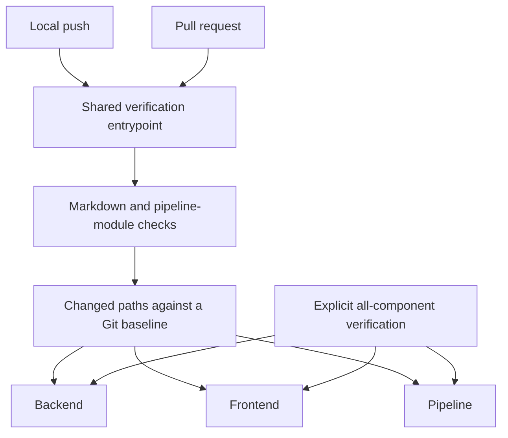

# Pipeline design

> Standard: Agentic Engineering Standards v1.2.0

## Purpose

The pipeline verifies candidate revisions and publishes authorized releases. Local pushes and pull requests use one verification entrypoint; affected-component selection avoids rebuilding unrelated application components.

Backend, frontend and pipeline gates own independent build boundaries in pinned environments. Selection follows path ownership, not file type: frontend-owned changes select the frontend gate; standalone living-doc changes retain shared checks without selecting an application component.

Changes to shared verification infrastructure or its environment select every component. The gates exercise actual application builds as well as selection policy.

## Verification boundary

Git ancestry defines the change under review. The pre-push hook verifies the actual outgoing checkout, while pull-request CI compares the candidate with its target branch. A failed stage stops verification rather than producing a partial success.

| Owner | Responsibility |
| --- | --- |
| Shared verification entrypoint | Markdown checks, pipeline-module validation and selected component execution. |
| Pipeline module | Path-selection policy and component gates. |
| Pre-push hook | Verify the outgoing HEAD from a clean checkout against the appropriate remote baseline. |
| GitHub workflows | Invoke verification for pull requests, all-component main checks and authorized publication. |

Direct Dagger verification runs component gates; it does not replace the shared entrypoint's Markdown and host-side module checks. [Contracts](contracts.md) links the definitions; [operations](operational.md) owns invocation.

## Release boundary

A maintainer dispatches publication from main. Host-side module validation and every component gate must pass before the pipeline builds and publishes an immutable, versioned image.

Release completion requires public GHCR visibility, a verified anonymous manifest read and a matching Git tag. Publication and tagging are separate outcomes: an image published before a later failure retains its version and must be recovered without replacement.

The NAS consumes published images independently of CI. The [deployment topology](../../specs/operational.md#run-on-the-nas) explains the template, container and storage relationships; the [operator runbook](../../unraid/README.md) owns installation and recovery.
