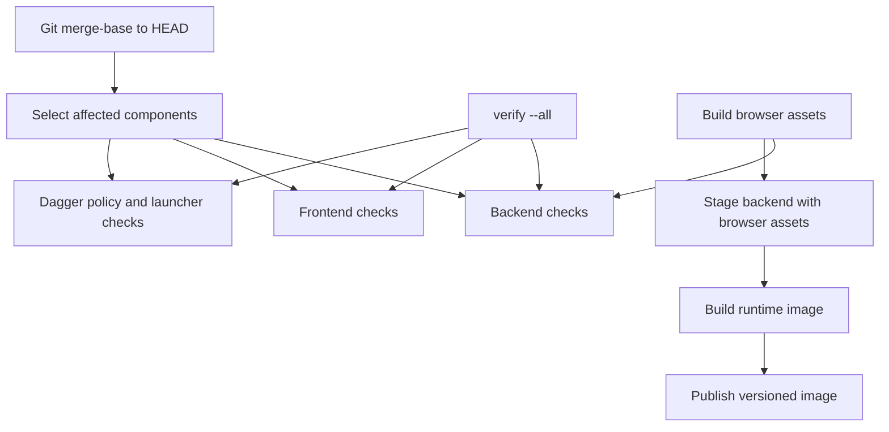

# Dagger design

Dagger checks the affected backend, frontend and pipeline components and builds the packaged application image. Git supplies the committed change set; component checks run in containers so local and hosted callers use the same build environment.

## Selection and execution

Selection follows path ownership, not extension. An ordinary product-doc change selects nothing; a Markdown change under shared infrastructure can select all components.

Selected components execute in backend, frontend, pipeline order. Failure stops the run; selecting pipeline also checks the local launcher and verification scripts, whereas the direct pipeline check runs only Dagger policy tests.

The backend check builds browser assets before testing the backend because the backend packages those assets. The frontend check independently validates browser code and its production build; selecting backend alone does not run frontend tests.

## Image delivery

Image assembly stages the JVM application with built browser assets, then applies the runtime Dockerfile and revision metadata. Build and publish do not run verification; their caller must establish that the source passed its gates.

Dagger publishes an image, not a complete GitHub release: the caller owns authorization, duplicate checks, package visibility and Git tagging. The service [deployment runbook](../../unraid/README.md#publish) owns that release procedure.
