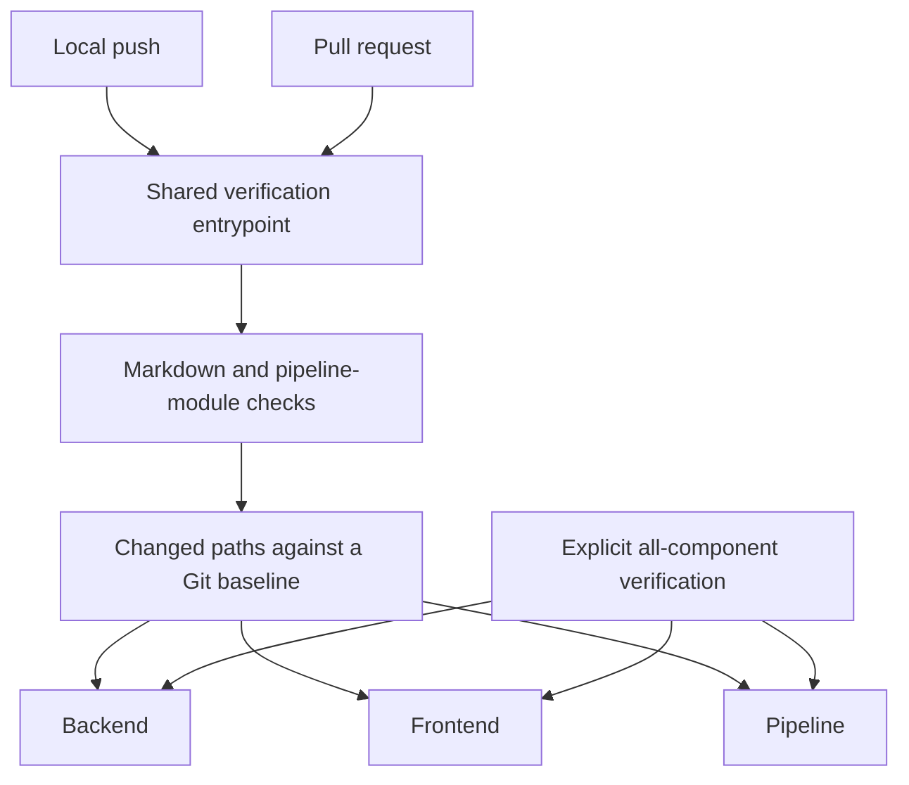

# Pipeline design

## Purpose

The pipeline verifies candidate revisions and publishes authorized releases.

Backend, frontend and pipeline gates own independent build boundaries. Selection follows path ownership, not file type; [selection policy](contracts.md#provided-contracts) owns the mappings.

Changes to shared verification infrastructure or its environment select every component.

## Verification boundary

A failed stage stops the pipeline.

| Owner | Responsibility |
| --- | --- |
| Pipeline module | Path-selection policy and component gates. |
| Pre-push hook | Validate the outgoing checkout before invoking shared verification. |
| GitHub workflows | Invoke verification for pull requests, all-component main checks and authorized publication. |

[Contracts](contracts.md) defines verification completion; [operations](operational.md) owns invocation and baseline selection.

## Release boundary

Publication follows host-side module validation and every component gate, then builds and publishes the application image. [Release contracts](contracts.md) owns version identity and registry requirements.

Publication and release completion are separate outcomes. An image published before a later access-check or tagging failure retains its immutable version; recovery completes that release rather than replaces the image.

The [deployment topology](../../specs/operational.md#run-on-the-nas) owns downstream container/storage relationships; the [operator runbook](../../unraid/README.md) owns publication and installation actions.
