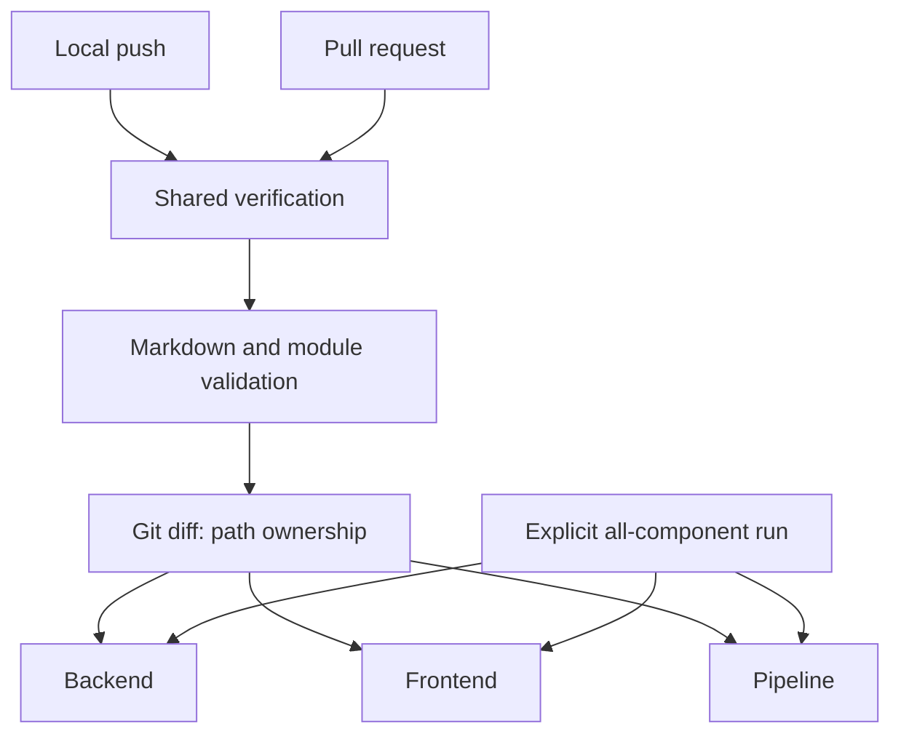

# Pipeline design

The hook validates the outgoing checkout; the shared entrypoint orchestrates checks; the Dagger module owns selection and component execution. Shared infrastructure changes select all components. A failed stage stops verification.

Release publication runs host module validation and all component gates before image assembly. Publication can precede an access-check or tagging failure; the existing immutable image remains recoverable, not replaceable.

[Contracts](contracts.md) defines boundaries; [operations](operational.md) owns invocation.
