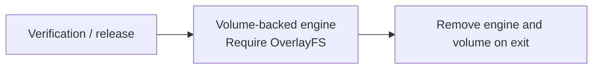

# Dagger operations

Run from the repository root with the [contributor toolchain](../../CONTRIBUTING.md#setup) installed and Docker available. Checks use isolated container state; the service and NAS need not be running.

## Select and check

Commit the candidate and fetch the comparison branch before selective verification. Selection compares committed HEAD with the merge-base, not local edits.

```sh
git fetch origin main
dagger call changed --base=origin/main
dagger call verify --base=origin/main
```

Use `dagger call verify --all` to check all components without Git selection. For a single gate, use `dagger call backend-check`, `dagger call frontend-check` or `dagger call pipeline-check`; [design](design.md#selection-and-execution) explains their different scope.

These commands do not replace the shared host checks required for publication; use [contribution validation](../../CONTRIBUTING.md#validation) for that entrypoint.

## Engine storage



For direct commands, use `bash scripts/with_dagger_engine dagger ...`. An explicit verification runner remains operator-managed.

Dagger uses a 20 GB GC target, not a hard quota for active builds. The volume and required OverlayFS prevent full-filesystem snapshot copies.

SIGKILL or Docker failure can leave resources behind. Inspect containers labelled `dagger.ephemeral=true` and their attached volumes before removing idle resources; never remove another active invocation.

## Actions cache

`build.yml` verifies affected PR components and runs full verification on main pushes or manual dispatch. Set the manual `cache` input to false for an uncached comparison. Main verification and publication restore trusted main caches without saving.

One `verify-cached` call imports runner-restored state into Dagger volumes, verifies, and exports a snapshot before disposable-engine cleanup. It retains Coursier, sbt boot, frontend npm downloads, and coverage-only compiler targets with sbt 2's native task store. `testFull` reruns every backend test; old coverage measurements are deleted and the transient scoverage report task computes current-run coverage. The frontend resource generator is uncached. Release compilation stays uninstrumented and separate; SDK generation and engine layers remain disposable.

Each snapshot is capped at 1.5 GB; oversized snapshots emit a warning and are not saved. All generations share GitHub's free default [10 GB repository allowance](https://docs.github.com/en/actions/concepts/workflows-and-actions/dependency-caching#usage-limits-and-eviction-policy), using native LRU eviction and seven-day idle expiry without paid storage. Keys combine OS, architecture, month, toolchain/build definitions, dependency locks and commit SHA. No fallback crosses monthly or dependency generations, so obsolete versions stop being restored and expire. Native PR scope isolates untrusted saves from main, and concurrent identical-key saves use the first successful upload.

## Build without publishing

```sh
dagger call build --version=dev export --path=.agent-work/photography-dev.tar
```

The result is a Docker-loadable image archive. The [runtime Dockerfile](../../containers/photography/Dockerfile) owns its packaging; [delivery ownership](design.md#image-delivery) explains the prerequisites.

## Diagnose failures

Keep the failing stage's output and candidate/baseline revisions. Dagger logs distinguish tool failures from engine/container setup failures; fix that boundary without bypassing the gate.

For unexpected selection, inspect `git merge-base origin/main HEAD` and `git diff --name-only origin/main...HEAD` before blaming the mapping. Missing ancestry can trigger the direct Git adapter's fallback; fetch the intended baseline and rerun.

If container Git commands cannot resolve a linked worktree's external metadata, use a full clone containing the same committed candidate and baseline. Keep the original worktree intact; changing the source container does not authorize skipping verification.
