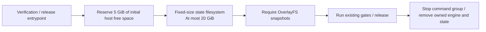

# Dagger operations

Run from the repository root with the [contributor toolchain](../../CONTRIBUTING.md#setup) installed and Docker available. Checks use isolated container state; the service and NAS need not be running.

## Select and check

Commit the candidate and fetch the comparison branch before selective verification. Selection compares committed HEAD with the merge-base, not local edits.

```sh
git fetch origin main
dagger call changed --base=origin/main
dagger call verify --base=origin/main
```

Use `dagger call verify --all` to check all components without Git selection. For a single gate, use `dagger call backend-check`, `dagger call frontend-check` or `dagger call pipeline-check`; [design](design.md#selection-and-execution) explains their different scope.

These commands do not replace the shared host checks required for publication; use [contribution validation](../../CONTRIBUTING.md#validation) for that entrypoint.

## Engine storage



The launcher requires capacity for at least 8 GiB of engine state. A full state filesystem fails the command rather than using more host storage; requiring OverlayFS prevents full-filesystem snapshot copies.

For direct commands, prefix Dagger with `python3 scripts/with_dagger_engine.py`. Verification and publishing provision the bounded engine automatically; an explicitly supplied verification runner remains operator-managed.

Failures print engine diagnostics before cleanup. After an uncatchable termination, inspect `photography-verification` before removing it and its `photography-verification-state` volume; do not remove an active invocation. Concurrent invocations reject the occupied name instead of allocating another disk.

The [retention installer](../../scripts/configure_dagger_engine.py) remains a safeguard for operator-managed default engines. It preserves unrelated user settings and installs the [age/size policy](../../scripts/dagger-engine.json) in Dagger's native configuration directory; existing engines need recreation or restart to read it. Garbage collection cannot reclaim active snapshots and does not provide the bounded launcher's disk quota.

## Build without publishing

```sh
dagger call build --version=dev export --path=.agent-work/photography-dev.tar
```

The result is a Docker-loadable image archive. The [runtime Dockerfile](../../containers/photography/Dockerfile) owns its packaging; [delivery ownership](design.md#image-delivery) explains the prerequisites.

## Diagnose failures

Keep the failing stage's output and candidate/baseline revisions. Dagger logs distinguish tool failures from engine/container setup failures; fix that boundary without bypassing the gate.

For unexpected selection, inspect `git merge-base origin/main HEAD` and `git diff --name-only origin/main...HEAD` before blaming the mapping. Missing ancestry can trigger the direct Git adapter's fallback; fetch the intended baseline and rerun.

If container Git commands cannot resolve a linked worktree's external metadata, use a full clone containing the same committed candidate and baseline. Keep the original worktree intact; changing the source container does not authorize skipping verification.
