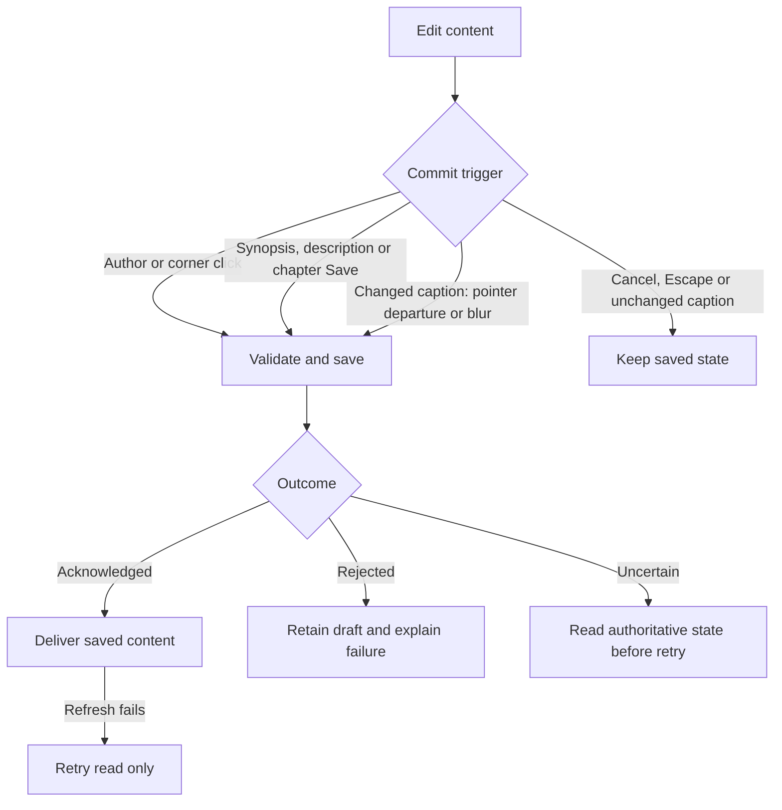

# Album content

**Date:** 2026-10-30

**Classification:** feature

**Grounded in:**

- Confirmed workspace spike, 2026-10-30: ordinary API saves retained editorial content, authors and gear after backend restart.
- Browser checks established immediate author saves, shared compatible lenses and direct caption editing with one implicit commit.
- Read-only legacy comparison established plain-text ownership, compact gear names, synopsis presentation and migration gaps.

## What & Why

The workspace edits composition but cannot author its persisted text or gear. Add editorial content and attribution to the ordinary editing journey, preserving the confirmed book presentation.

## Domain / Design Notes

### Content ownership

| Content | Authoritative owner | Delivery |
| --- | --- | --- |
| Synopsis | Album | Synopsis opening |
| Authors | Album; nonempty selection of Cosmin, Mara and Iacob | Cover credits in that display order |
| Description | Chapter; plain text distinct from metadata and gear | Chapter opening |
| Gear selection | Chapter; cameras with lenses for each interchangeable body | Chapter opening footer |
| Caption | Photo; independently of its placement | Occupied interior photo slot |
| Caption corner | Interior placement; one of four corners | Caption alignment within its photo |
| Cameras and lenses | Shared editable catalogs | Chapter gear choices and saved selections |

Text preserves Unicode, punctuation and meaningful line breaks as plain text. Empty synopsis, description and caption are supported; clearing a caption removes its visible label.

Chapter headings, date wording and gear lines derive from structured chapter data, not from parsing the description. Legacy combined text requires separate reconciliation before backfill.

### Save and recovery

Ordinary HTTP mutations and reads own persistence; reload and backend restart retain successful changes. Saves affect their named content, leaving unrelated editorial and composition state intact.

Chapter metadata and gear share an editor, not an implied all-or-nothing transaction. If metadata saves before gear fails, recovery identifies the saved portion and retries only unresolved work.

| Enforcing owner | Guarantee |
| --- | --- |
| Database | Primary keys identify catalog entries; foreign keys preserve chapter, photo, placement and gear references. |
| Database | Unique keys prevent duplicate chapter/body and body/lens selections; corner `CHECK` constraints restrict interior corners. |
| Application | Author selections are nonempty, unique and restricted to the three supported names. |
| Application | Gear uses current catalog entries; fixed-lens cameras have no selected lenses, interchangeable bodies have at least one. |
| Application | Compatibility and referenced-catalog edits are validated under the existing single-backend mutation coordination. |
| Persistence | Each content mutation or complete gear replacement commits atomically; rejected changes leave saved state unchanged. |
| Browser | Pending or uncertain saves visibly resolve before navigation or conflicting actions discard their state. |

Lenses cease to belong to one camera. A compatible lens has the same mount and sufficient coverage: full-frame bodies require full-frame lenses; APS-C bodies accept either coverage on the same mount.

The application rejects catalog changes that invalidate saved selections. Database references prevent deleting used entries; unused cameras and lenses have independent lifecycles.

Existing album attribution is initialized to its previously displayed credits: Cosmin and Mara through 2025, all three thereafter. New albums default to all three regardless of year.

Existing editorial content, identities, gear selections and composition survive the schema transition. Compatibility facts must be established from known equipment, never guessed for unknown retained entries.

If retained equipment cannot be classified, the transition stops with an explicit error and leaves retained data unchanged.

## Invariants

- Original photographs remain read-only; photo reconciliation preserves authored captions.
- Moving interior photos carries their corners; template replacement follows the existing ordered retention contract.
- Album year, chapter ordering, collection ownership and Cover spine ownership retain their existing rules.
- Reader presents the same saved book content without editing chrome.

## Acceptance Criteria

### Authors and text

- Place the grouped Cosmin/Mara/Iacob multi-toggle after the album title and a vertical separator.
- Every nonempty author combination saves immediately and determines Cover credits after reload.
- Attempting to deselect the final author leaves it selected and explains the requirement.
- New albums select all three authors; existing albums retain their previously displayed attribution.
- Author options size to their labels with equal 8px horizontal padding.
- Author and Spreads/Cover groups have rounded outer corners and the same darker selected, hover and focus color.
- Synopsis and chapter descriptions save and clear through ordinary APIs, preserving plain-text line breaks.
- Cancelling a text edit preserves saved content; failed saves retain the draft with recoverable feedback.
- Use `Chapter description for <name>` with the saved name and no Text subtitle.
- Synopsis and description editors use unframed floppy-disk Save and red-X Cancel icons with accessible names.

### Captions

- Captions sit flush against their selected horizontal edge with a 3% vertical inset.
- Multiline captions align each line to that horizontal edge in both editing and Reader.
- Clicking the actual caption edits that label directly with unchanged typography, background and padding.
- Empty captions expose an Add caption affordance on hover or keyboard focus.
- Editing adds no toolbar or dialog; typing sends no mutation.
- The first pointer departure commits changed text once, including departure immediately after entering edit mode.
- Keyboard focus departure also commits changed text once; coincident blur and pointer departure do not duplicate it.
- Escape restores the original caption and sends nothing, including on subsequent blur or pointer departure.
- Leaving unchanged text closes editing without a mutation; clearing changed text persists an empty caption.
- Failed caption saves preserve the draft and expose explicit retry/reconciliation feedback.
- The photo toolbar has two rows of three: move/mirror/remove, then the three alternative caption corners.
- Each alternative corner saves directly; the selected corner is omitted from those three choices.
- Corner changes preserve caption text, crop and transforms; caption changes preserve the corner.
- Saved captions remain with photos after removal and replacement; new placement uses the existing initial-corner rule.

### Chapter dates and gear

- Chapter metadata and gear share a split editor; narrow layouts stack without horizontal overflow.
- Date controls edit day/month beside fixed years; new dates use the album year.
- Existing dates preserve their individual saved years, including cross-year chapters.
- Invalid dates or out-of-year input show validation without silently changing the fixed year.
- Chapter gear permits no cameras, fixed-lens cameras, or interchangeable bodies with nonempty compatible lens selections.
- One shared lens can be selected for multiple compatible bodies without becoming unavailable to another body.
- Wrong mounts and APS-C lenses on full-frame bodies are rejected without changing saved gear.
- Full-frame lenses are selectable on same-mount APS-C bodies.
- Exhausted lens selectors disappear; removal restores the choice and maintains usable keyboard focus.
- Camera/lens catalog management opens from chapter gear in split panels with quiet controls and aligned subtitles.
- Open catalog management with the usual pencil immediately to the right of Gear.
- Fresh databases contain the confirmed equipment inventory, including historical phones needed for rebuilding old albums; the shared catalog remains editable.
- Each catalog panel has its Add icon at the right of its heading; narrow layouts stack the panels.
- Catalog create/edit exposes mount and sensor format or lens coverage where applicable.
- Editing compatibility or camera kind rejects changes that invalidate saved chapter selections.
- Deleting a used entry reports a conflict; deleting an unused camera neither deletes nor owns its lenses.
- Chapter-save recovery distinguishes saved metadata from unresolved gear and avoids repeating successful writes.

### Book presentation and delivery

- Preserve confirmed chapter typography: 30pt heading and 11pt body in book coordinates, with normal-weight text editors.
- Sigma prime lenses with the same suffix share their brand and suffix; variants use `&`, distinct lens groups use `+`.
- Galaxy models share the Samsung Galaxy prefix; FE attaches to its model number. Stored catalog names remain unchanged.
- Gear groups and variants retain selection order; each group appears at its first selected member.
- Synopsis uses the confirmed 80%-page-width gray column with white text and a full-column white flag band.
- The band shows deduplicated chapter countries in country-code order; flags measure 42×28pt with bottoms 80pt above the text-slot bottom.
- Unavailable flag artwork produces explicit feedback rather than a broken image or silently missing country.
- Reader preserves synopsis contrast, chapter typography, gear, attribution and saved captions without editing controls.
- Routine saves preserve rendered book content, workspace metadata, navigation and dialog geometry without document reloads, temporary save overlays or reacquiring unchanged layout/gear choices.
- Temporary save guards retain controls' normal visibility; accessible busy descriptions leave the layout unchanged.
- Controls remain keyboard accessible, retain meaningful focus after changes and expose reasons for unavailable actions.
- Malformed content or invalid selections return validation feedback; missing targets report missing/stale state.
- Successful saves followed by failed refresh retry authoritative reads without replaying the mutation.
- Uncertain write outcomes reconcile before retry; failed reads never appear as successful empty content.
- API reads and the reopened workspace agree after backend restart for every edited content type and catalog selection.

Representative footer output:

| Selected names | Display |
| --- | --- |
| Sigma 30mm f/2.8 DN Art; Sigma 60mm f/2.8 DN Art | Sigma 30 & 60mm f/2.8 DN Art |
| Nikkor 28-400mm f/4-8; Viltrox 16mm f/1.8 | Nikkor 28-400mm f/4-8 + Viltrox 16mm f/1.8 |
| Samsung Galaxy S22; Samsung Galaxy S24 FE; Samsung Galaxy S25 | Samsung Galaxy S22 + S24FE + S25 |

## Doc Sync

- `specs/design.md` — Album model: integrate editorial ownership, persisted attribution and shared compatible gear into the book model.
- `specs/http-api.openapi.json` — Own content, attribution, corner and gear/catalog mutation contracts, validation and recovery responses.
- [SQLite migrations](../../../backend/src/main/resources/db/) — Own shared-lens compatibility, attribution and retained references.

## Out of Scope

- Six-album backfill and destination selection; source reconciliation requires separate authorization before any destination writes.
- Legacy geometry/bleed/crop conversion, multi-folder chapter mapping and inferred date/country metadata.
