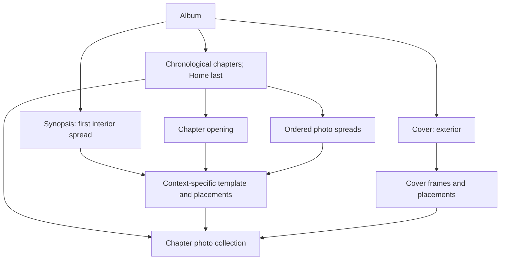
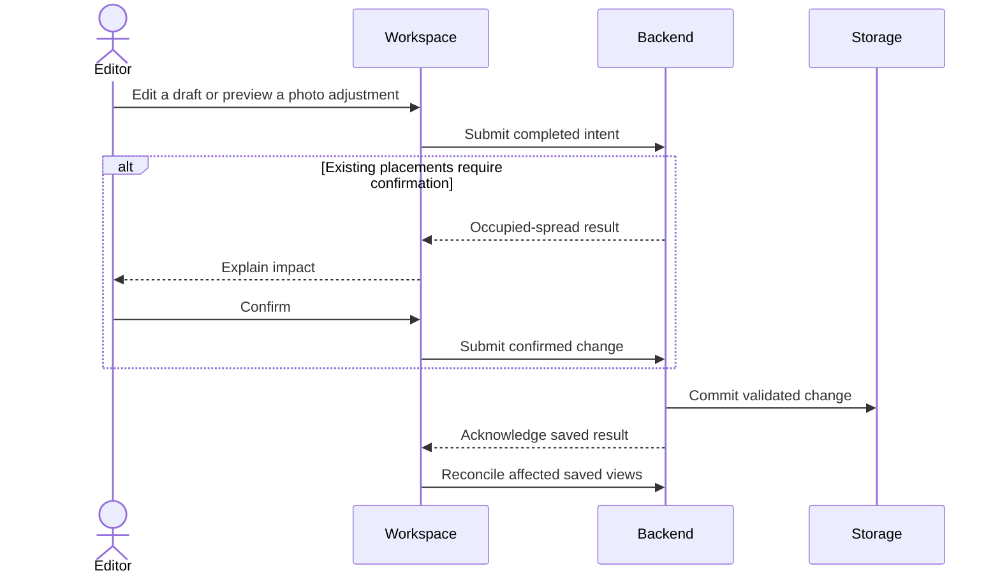

# Photography design

## Book ownership

Album Layout Studio stores editorial decisions and composition, not the authoritative original-photo archive.

An album has a unique immutable year and independently editable title. Chapters describe destinations and visit periods; Home covers the whole year, and each chapter opening precedes its photo spreads.

| Owner | Saved facts and constraints |
| --- | --- |
| Album | Synopsis and a nonempty author selection; Cover credits derive from those authors. |
| Chapter | Destination/date/source metadata, plain-text description and ordered gear selection. |
| Photo | Caption and source metadata, independently of whether the photo is placed. |
| Interior placement | Frame transform and caption position; it references photo-owned text. |
| Cover | Exterior composition, saved spine owner and print specifications. Frames derive from actual interior page count; the spine owner's photo frame includes the spine. |
| Shared gear catalogs | Cameras and lenses have independent lifecycles. Chapter selections must remain compatible with current catalog entries; a lens can serve several bodies. |

The book allows at most 65 interior spreads, excluding Cover. Templates supply context-specific geometry from reference catalogs rather than separate editor/Reader rules.

Chapter spreads use photos from that chapter; Synopsis and Cover can use the album collection. Collection membership survives removal of a spread, which releases placements rather than deleting photographs.

## Saved edits and recovery

The workspace keeps the selected book part addressable across navigation and reload. Catalog cards show both Cover faces and actual page count, refreshing on catalog reentry; editor and Reader share saved composition and presentation policy.

Reader removes editing controls, not book content.

Completed photo adjustments save in order while previews remain local. Cancellation leaves saved state unchanged; rejection or failed saves retain recoverable drafts instead of presenting them as saved.

An acknowledged write followed by failed acquisition needs another read, not another mutation. An uncertain write outcome must be reconciled before retrying; stale in-flight reads cannot replace acknowledged saved state.

One editor can span separately saved owners: chapter metadata saves before gear, so recovery preserves the committed portion and retries only unresolved work. Unrelated content and composition remain unchanged.

Navigation resolves pending edits and uncertain saves before leaving. Focus remains with the owning edit or recovery surface; temporary guards explain their reason without moving controls or hiding failures.

Album renaming belongs to Synopsis but does not change its content ownership. Spread-wide bleed preserves template geometry: full-height outer photos bleed vertically and outward while an opposite stack stays inset; otherwise outer stacks bleed outward together, with inner slots inset.

Mixed saved bleed directions remain readable and are not normalized on load. The disabled toggle explains that state; standard directions can be enabled or cleared through the normal protected save.

## Undo/Redo

Completed user intent forms one browser-local chronology, including edits spanning content owners. Navigation and Reader retain it; album exit, reload or unexpected access loss ends it.

Undo/Redo uses ordinary authoritative commands with current ownership, not whole-album snapshots. Restored composition can receive new identities, which retained history follows without reverting unrelated edits.

Compensation is best effort: interrupted actions retain progress, and a blocked or uncertain newest action stops traversal. Chapter creation and source-photo replacement establish history boundaries; shared-catalog changes remain outside book history.

## Browser editing ownership

A browser profile remembers an identity and editable alias. A tab establishes a backend-bound connection before entering the application; only one tab per profile is admitted, and additional tabs wait for release or expiry.

One session can own one interior spread or the whole Cover. Other profiles can view saved state and use Reader, see the owner's alias and acquire after release/expiry; there is no forced takeover.

| Requires target ownership | Independently writable |
| --- | --- |
| Composition, placed-photo captions, Synopsis, chapter-opening description, template changes and spread deletion | Album title, chapter name/countries/dates/source, gear and catalog edits, author selection, nondestructive insertion/reordering and photo-source processing |

Chapter-description writes resolve the current opening under the same coordination as ownership admission and persistence. A view-only target hides editing affordances while preserving independent chapter details and recoverable drafts.

Tab binding, session liveness and target grants have separate lifetimes. Closing a stream releases only its exact tab binding; a live session/grant can resume after reload, while releasing a target retains the session.

Selecting another spread or Cover releases the old grant before acquiring the new target or showing it view-only. Reader and album exit release target ownership.

An ownership event is an invalidation, not a grant. Waiting viewers attempt acquisition only after local work resolves; successful acquisition reloads authoritative saved state before enabling edits.

Connection/ownership uncertainty blocks editing and retains drafts; backend loss blocks the whole application. Reconnection/reacquisition requires saved-state reconciliation and explicit draft review, never automatic replay.

The backend keeps this authority in memory, so restart invalidates temporary credentials/grants but preserves saved albums and remembered browser identity. Session heartbeats and target renewals extend separate leases; failed attempts extend neither.

## Photo reconciliation and live reads

Saving a chapter commits independently of background processing. Creation, source-folder replacement or Refresh schedules reconciliation; opening an album reads saved state without rescanning originals.

Only one chapter source processes at a time; other requests queue. Superseding work releases that capacity without publishing stale photos.

Complete photos appear progressively through inventory invalidations. Replacement or recoverable failure retains existing usable photos, and refreshed metadata/thumbnails preserve authored captions.

Durable write intents bridge database and thumbnail-file publication/cleanup. Runtime recovery finishes interrupted intents before serving, while source enumeration remains explicitly requested.

Inventory and ownership events tell the browser to reread; they do not form a second database. Ordinary saved edits are reconciled on navigation, acquisition and reconnect rather than streamed into an already-open view.

Workspace acquisition combines content, chapter structure, saved composition and inventories. Their identities, chapter blocks and opening order must agree; incoherent acquisition retries at most twice, then reports failure while retaining the last usable view.

Each saved spread supplies geometry with placements for both editor and Reader. Acquisition retains pending adjustments and uncertain-write feedback instead of silently discarding them.

## Mutation coordination and print assembly

Application operations decide business changes through ports; adapters translate external representations and persist supplied decisions. The [engineering principles](../DESIGN-PRINCIPLES.md) govern that separation, and [contracts](contracts.md) identify the boundaries.

Protected writes validate live session, connection, grants and current affected relationships in the same coordinated interval as completion. A write admitted while ownership is live may finish across expiry; competing acquisition waits and observes its committed result.

Shared protected writes reject atomically when another session owns any affected target. Relationship-read failures remain failures, not an empty affected set; slow original-photo/image work stays outside this critical section.

Placement, structural editing and photo reconciliation share mutation coordination to preserve collection membership and exclusive photo use across interior and Cover. SQLite enforces relational validity and atomic persistence; application operations own the preceding decisions.

Print export assembles saved facts from their existing owners and validates print readiness after editing stops. InDesign owns local resources and final composition; [operations](operational.md#print-handoff) describes the handoff.
