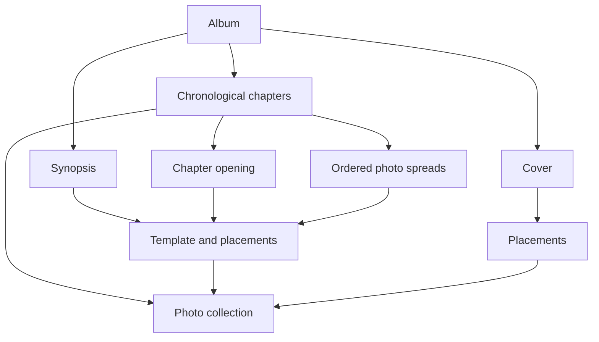

# Photography design

Album Layout Studio composes chapter-organized photographs into a saved book. The browser edits and presents that book; InDesign produces the final print composition.

## Book model

An album has a unique immutable year and editable title. Home covers the whole year and stays last; chapter openings precede their photo spreads. The interior allows at most 65 spreads, excluding Cover.

Editorial text belongs to content owners, not layouts: album synopsis and authors, chapter description and gear, and photo captions. Placements own caption position. Shared camera/lens catalogs preserve every saved selection's compatibility.

Chapter layouts use their chapter's photos; Synopsis and Cover use the album collection. Removing a spread releases placements, not photos. Cover geometry derives from saved print specifications and the actual interior page count, including the spine frame.

Bleed preserves template geometry and placement identities. A full-height outer photo bleeds top, bottom and outward while the opposite stack stays inset; otherwise both outer stacks bleed outward. Inner slots stay inset. Mixed saved directions remain readable with an explained disabled toggle.

## Editing

Catalog, workspace and Reader share saved composition. Navigation retains the selected part; catalog re-entry refreshes both cover faces and page count.

Photo adjustments preview locally and save in order when completed. Cancellation preserves saved state; rejected saves retain recoverable drafts. Destructive placement changes require confirmation.

Each owner commits atomically, preserving unrelated work. Cross-owner edits can partially succeed: chapter metadata resolves before gear saves separately. After acknowledgement, retry failed reads rather than the write; reconcile uncertain outcomes before another write. Unavailable reads retain the last usable view.

One browser-local Undo/Redo chronology records completed intent. Reversal uses ordinary commands, follows regenerated identities and preserves unrelated work. Interrupted compensation retains progress; a blocked or uncertain newest action stops traversal. Chapter creation and source replacement establish history boundaries. Album exit, reload or unexpected access loss ends history.

Navigation resolves pending edits first. Saves and guards retain spatial context and accessible recovery controls; focus follows the owning interaction.

## Editing authority

A profile remembers an editor identity and alias; the alias is not authentication. Only one application tab per profile is admitted.

Tab connections, session leases and target grants have separate lifetimes. Stream closure releases that exact connection; heartbeats renew sessions and target renewals extend grants. Transport keepalives renew neither. A live session/grant can resume after reload.

One session owns one interior spread or the exterior Cover. Other profiles view saved content until release or expiry. Composition, placed captions, synopsis, opening descriptions, templates and spread deletion require ownership; album/chapter metadata, gear/catalogs, authors, insertion/reordering and source processing remain independently writable.

Selecting another target, entering Reader or leaving the album releases the grant. Acquisition reconciles saved state before enabling edits. Notifications only prompt acquisition; uncertainty retains drafts and blocks editing, while backend loss makes the application unavailable.

Protected writes check current relationships and authority through completion. Admitted writes can finish across expiry; competing acquisition waits. Shared writes reject atomically if another session owns an affected target. Slow image/source work remains outside this interval.

## Photo reconciliation

Chapter creation, source changes and Refresh schedule background processing independently of chapter saves. One chapter runs at a time; others queue. Superseded work cannot publish stale results.

Complete photos appear progressively. Replacement and recoverable failures retain usable data and authored captions. Durable intents coordinate SQLite and thumbnail publication/cleanup.

Inventory and ownership events invalidate views; clients read authoritative state rather than treat events as saved data. Workspace acquisition requires coherent identities, chapter blocks and opening order; it retries incoherence at most twice, then uses the read-failure behavior above.

Spread and Cover reads supply geometry with placements, preserving pending adjustments and uncertain-write feedback. Acknowledged writes outrank older in-flight reads.

## Responsibility boundaries

Domain defines validity; application operations acquire facts and coordinate decisions; ports isolate HTTP, persistence, source files and thumbnails. Adapters translate external representations and preserve failure causes; composition binds infrastructure and owns resources.

Workspace and editing reuse saved-composition acquisition. Placement, structure and photo processing share mutation coordination. Print export assembles saved facts after editing stops; InDesign owns local resources and final composition.
