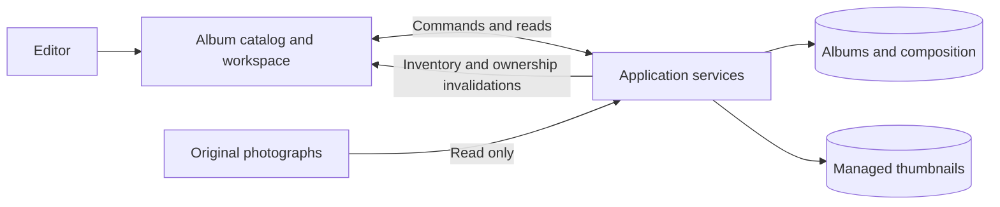
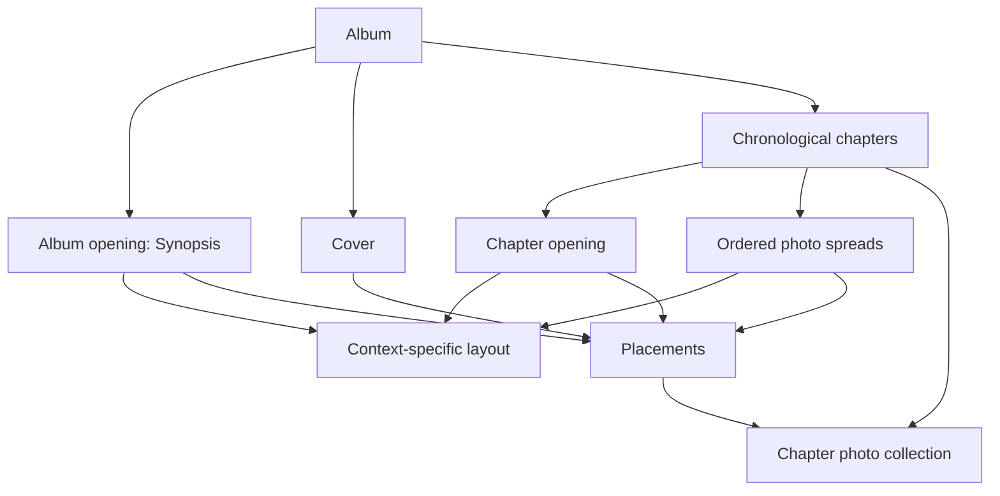
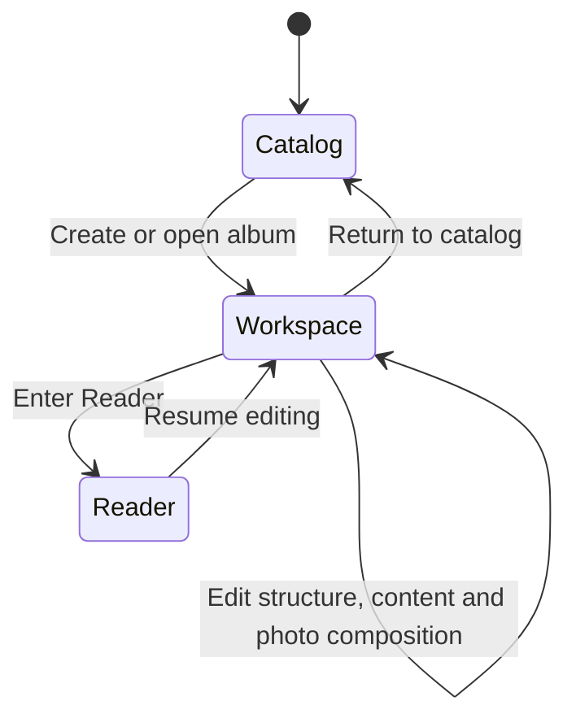
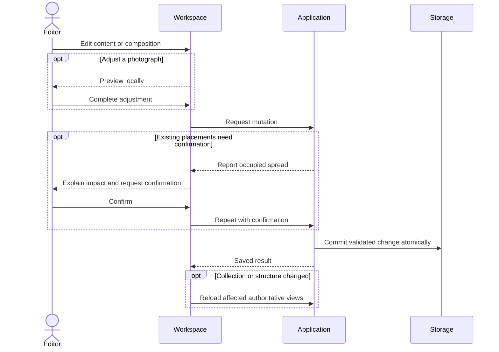
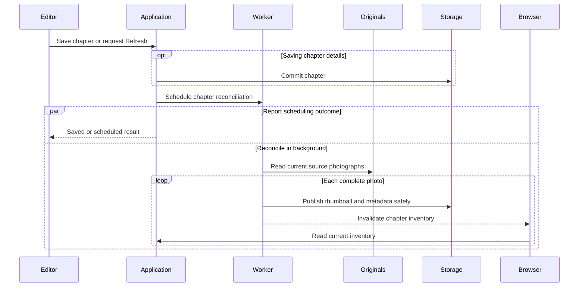

# Photography design

> Standard: Agentic Engineering Standards v1.2.0

## Purpose and system boundary

Album Layout Studio turns a year's chapter-organized photographs into a persisted album composition. The browser combines a photo collection, a spread editor and a distraction-free Reader; one backend serves the application and owns saved state.

Original photographs remain independently owned. The application stores editorial decisions and derived previews, rather than becoming the authoritative photo archive.

## Album model

An album has a unique, immutable year and an editable title. Chapters describe destinations and visit periods; Home represents the whole year and remains last. The interior starts with Synopsis, followed by chapter blocks whose openings stay ahead of their photo spreads.

Editorial content belongs to the book's domain owners, independently of layout:

| Owner | Content and relationship |
| --- | --- |
| Album | Synopsis and a nonempty author selection from which Cover credits derive. |
| Chapter | Plain-text description and ordered gear selection, separate from destination and visit-period metadata. |
| Photo | Caption retained independently of placement. |
| Interior placement | Caption position within the layout, separate from photo-owned text. |

Cameras and lenses have independent, shared catalog lifecycles; chapters select compatible equipment rather than owning catalog entries. A lens can serve several bodies, so changing or deleting one entry must preserve the validity of every saved selection that references it.

The application decides compatibility against current catalog state, while database constraints preserve references and atomic persistence. [Contracts](contracts.md) link the authoritative selection rules and representations.

Book presentation preserves editorial text and derives headings and supporting information from structured data. Editing, navigation and Reader share presentation policy over saved composition, keeping content and catalog identities with their existing owners.

Composition is bounded by the physical book: at most 65 interior spreads, excluding Cover. Templates provide layout geometry for their context; reference catalogs remain data, not duplicated application policy.

Cover artwork dimensions derive from the actual interior page count and persisted print specifications. The saved spine owner includes the spine in its photograph's frame; catalog, editor and Reader share those authoritative frames and saved transforms.

Photos belong to chapter collections independently of their use in layouts. Chapter spreads use their chapter's photos; Synopsis and Cover can use the album collection. Removing a spread releases its placements rather than deleting its photographs.

## Editing journey

The workspace keeps the selected part addressable and restores it across navigation and reloads. Structural editing operates within chapter boundaries; template choices follow the selected spread's context.

Photo editing persists placements and transforms for interior layouts and Cover; collection availability is derived from saved placements. Reader presents the same saved book content and composition without editing chrome.

Bleed selects one spread-wide mode: full-height outer photos bleed top, bottom and outward, leaving an opposite stack inset; without a full-height outer photo, outer stacks bleed outward together. Inner slots remain inset, and imported and newly created spreads use the same rule without changing template geometry or placement identities.

The command box starts the metadata row and groups bleed with chapter editing. Mixed saved directions remain readable without mutation and have an explained disabled toggle; standard directions can be enabled or cleared through the existing spread save and ownership boundary.

Album cards display both saved cover faces and the actual interior page count, refreshing when the catalog is re-entered. Album renaming belongs to the Synopsis command box and preserves independent title ownership.

Local previews stay responsive while completed adjustments save in order. Failed saves retain an explicitly unsaved preview for recovery.

Cancellation preserves saved state, and rejected saves retain the draft with recoverable feedback. Validated mutations commit within their owning boundary, preserving unrelated content and composition.

Saving and delivering the saved result are distinct outcomes: once a write is acknowledged, recovery retries authoritative reads rather than replaying the mutation. Uncertain outcomes are reconciled before another write attempt; unavailable state remains an explicit failure rather than successful empty content.

An editor spanning several owners does not imply an all-or-nothing transaction. Chapter metadata resolves before gear commits separately; partial-save recovery preserves the saved portion and retries only unresolved work.

Book editing has one browser-local Undo/Redo chronology over completed user intent, including edits spanning several content owners. Navigation and Reader retain that intent without retaining editing authority; album exit, reload or unexpected access loss ends its lifetime.

Reversal uses ordinary authoritative commands and current ownership, preserving unrelated work rather than restoring whole-album snapshots. Visible composition can be restored with regenerated identities, which retained history follows.

Compensation is best effort, not an atomic restoration transaction: interrupted work retains progress, and a blocked or uncertain newest action stops traversal. Chapter creation and source-photo replacement establish explicit history boundaries; shared-catalog changes remain independently owned.

Editing keeps book content primary and preserves the user's spatial context through saves. Temporary guards prevent conflicting actions without hiding controls or shifting the layout; their reasons are accessible, while errors and recovery actions remain visible.

Navigation resolves pending edits and uncertain saves before leaving. Focus follows the owning edit or its recovery surface without stealing unrelated focus or scrolling the workspace.

## Browser editing ownership

A browser profile remembers its identity and automatically chosen, editable alias. Aliases identify editors, not authenticated users.

Each document establishes a backend-bound tab connection before opening the application. Only one application tab per profile is admitted; additional tabs remain blocked until the previous binding is released.

One session may own one interior spread or the full exterior Cover. Other profiles retain saved-state viewing and Reader, see the owner's alias, and acquire only after release or expiry without forced takeover.

Target ownership protects composition, placed-photo captions, synopsis, chapter-opening descriptions, template changes and spread deletion. Chapter name, countries, dates, source, gear/catalog edits, author selection and nondestructive insertion/reordering remain independent of target locks.

Description writes resolve the chapter's current opening under the same coordination as ownership admission and persistence. A view-only canvas presents photographs, captions and opening text without editing affordances; independent chapter details and Reader remain available, and existing drafts remain recoverable.

Album title/deletion and photo-source processing remain independently writable. Editing grants coordinate access without changing which domain owner holds the content.

Tab binding, session liveness and target grants have separate lifetimes. Stream closure releases only the exact tab connection; a still-live session and grant can resume after reload, while releasing a target keeps its session.

Selecting another spread or Cover releases the previous grant, then acquires the destination or presents it view-only. Entering Reader or leaving the album releases target ownership.

Ownership invalidations let waiting viewers attempt acquisition once local work is resolved. A successful acquisition reconciles saved content before editing; a notification alone never grants access.

Connection or ownership uncertainty blocks editing and retains drafts, with backend loss making the whole application unavailable. Reconnection or reacquisition requires authoritative reconciliation and explicit draft review, never automatic replay.

## Photo processing and live views

Chapter saves commit independently of background photo processing. Creation, a changed source folder or an explicit Refresh initiates reconciliation; opening an album reads saved state.

Complete photos become visible progressively, retaining existing usable data during replacement or recoverable processing failure. Source reconciliation preserves authored captions independently of updated metadata and thumbnails.

Durable write intents bridge database and filesystem updates so restart recovery can finish interrupted publication and cleanup.

The browser treats inventory and ownership events as invalidations, not a second database. Ordinary saved edits are read on navigation, editing acquisition and reconnect rather than streamed into an already-open view.

Workspace acquisition assembles authoritative content, structure, composition and photo inventories. Resources must agree on identities, chapter blocks and opening order; incoherent acquisition is retried at most twice, then reports failure while retaining the last usable view.

Each saved spread supplies geometry and placements together for editing and Reader. Selecting an interior spread or Cover reconciles current saved state without discarding pending adjustments or uncertain-write feedback.

Acknowledged saved state takes precedence over older in-flight reads. Workspace views reconcile authoritative state before publication so background acquisition cannot undo a successful edit.

## Architectural decisions

Domain and application policy stay independent of HTTP, SQLite and image/filesystem adapters, following [Design principles](../DESIGN-PRINCIPLES.md). The composition root supplies concrete infrastructure.

One backend owns volatile browser access and shared mutation coordination. Protected mutations check current relationships and live session, connection and grant authority in the same interval as completion.

A write admitted while ownership is live may finish atomically across expiry; competing acquisition waits and observes that result. Expired or superseded credentials cannot authorize a later admission.

Shared protected writes prove caller-owned grants and reject atomically when any affected target belongs to another session. Failed relationship reads remain errors rather than an empty affected set.

Routes declare access requirements; application operations decide ownership while content managers retain business validation. HTTP adapters translate credentials, and SQLite commits supplied decisions atomically; slow source and image work stays outside the critical section.

Browser photo editing mutates placement resources; the interior composition owner also decides observed-order replacement, preserving the opening and membership atomically. Lightweight album, chapter and membership reads use their existing persistence authorities and representation validation, while atomic business workflows retain aggregate acquisition. Placement, structural editing and photo reconciliation share mutation coordination, preserving collection ownership and exclusive photo use across interior and Cover. The runtime owns resource acquisition and release, with recovery completed before serving. [Contracts](contracts.md) identify authoritative representations; [operations](operational.md) owns deployment and recovery.
