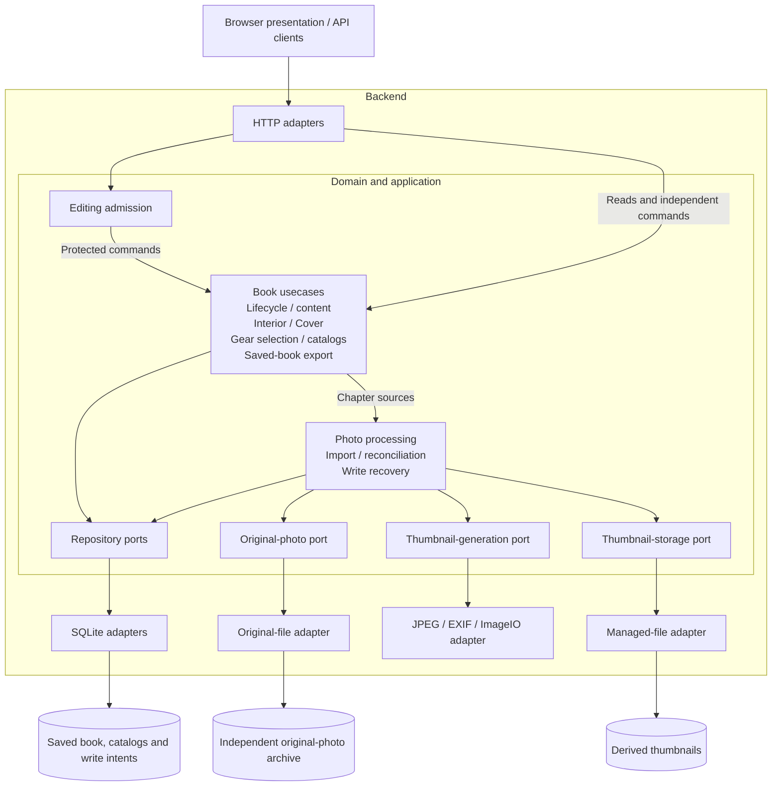
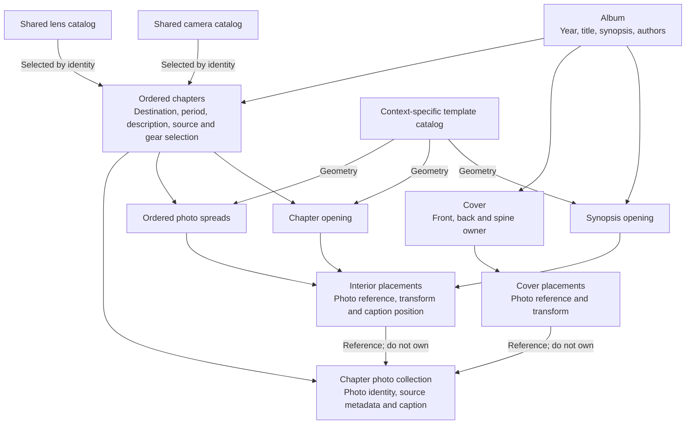
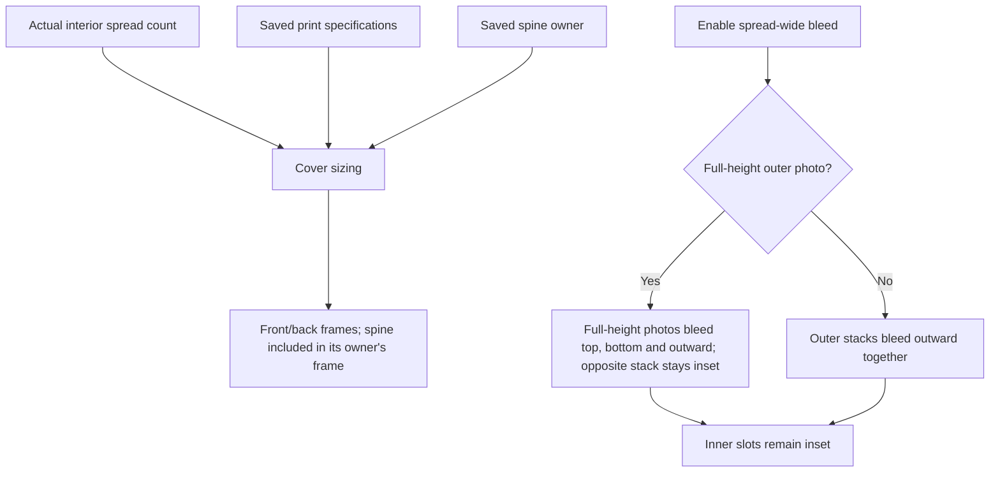
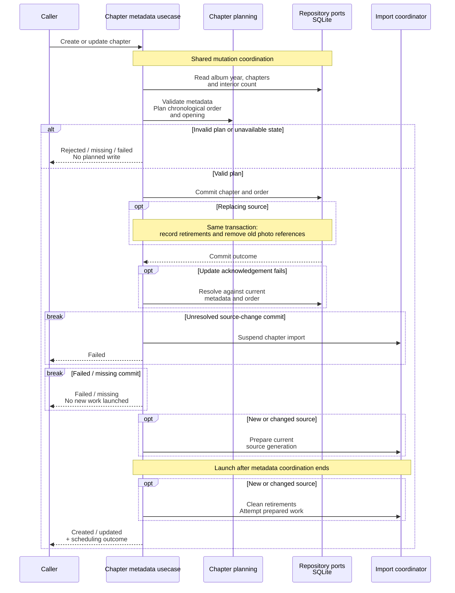
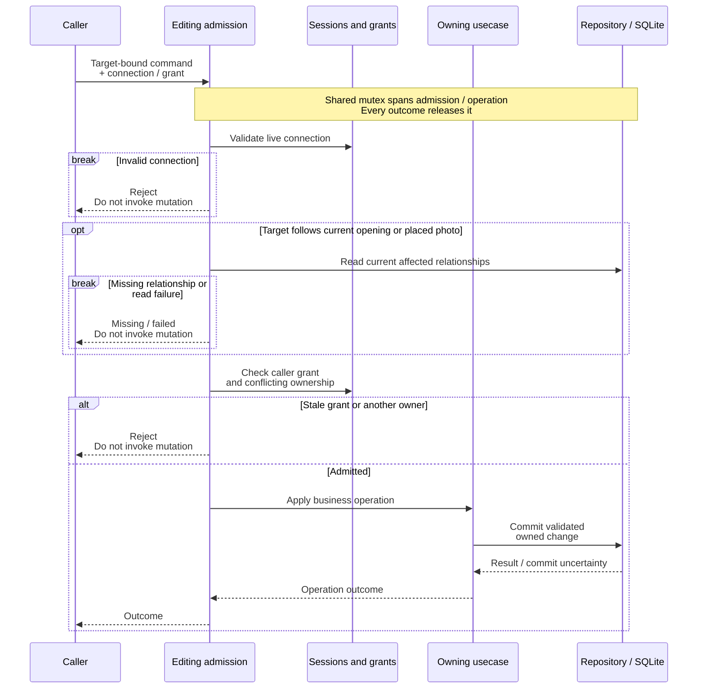
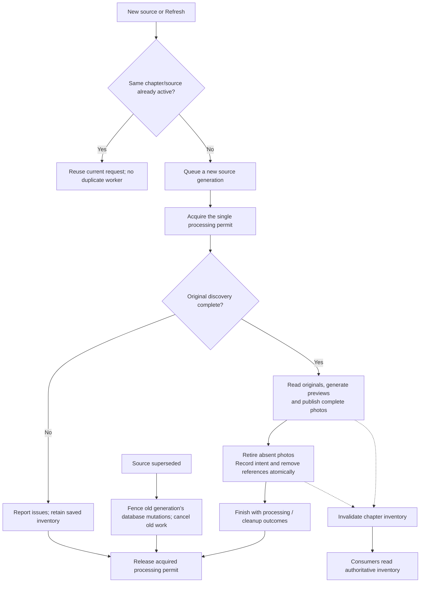
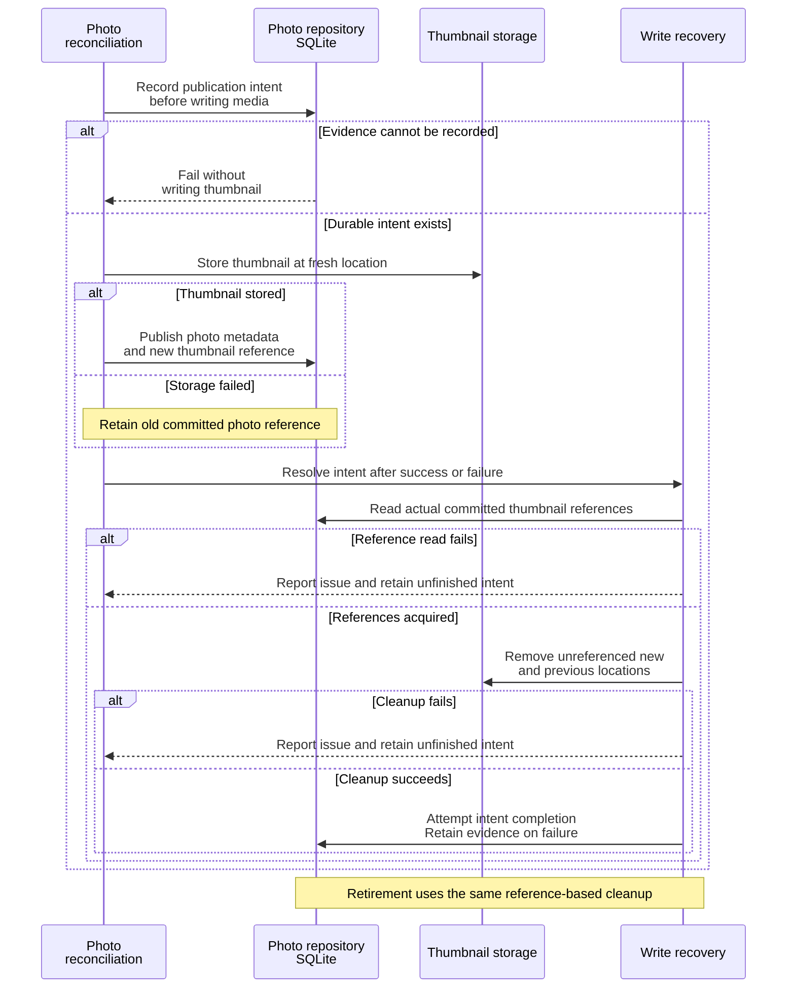
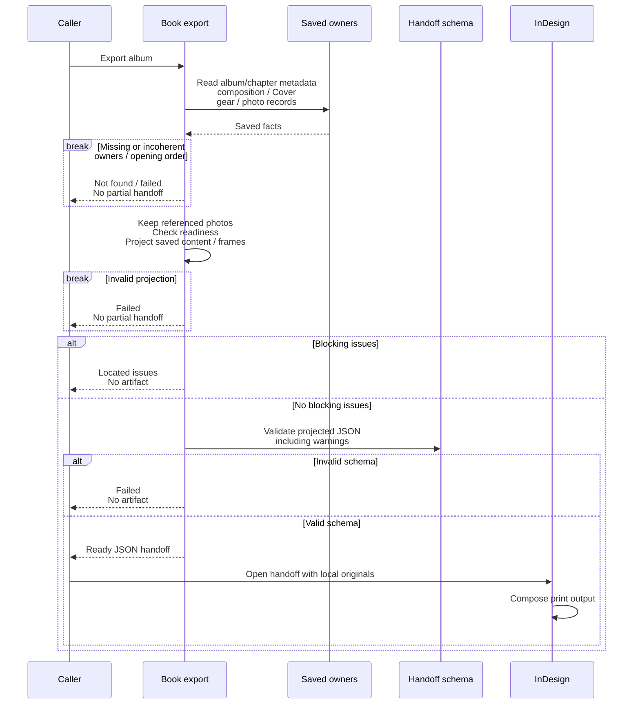
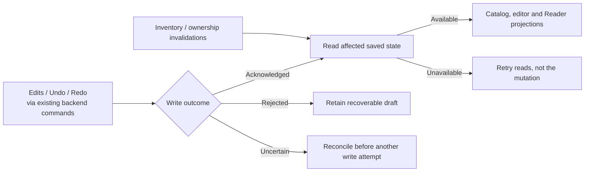

# Photography design

## Backend responsibilities

[External protocols and formats](contracts.md).

## Book model

**Invariants**

- Album years are unique and immutable; author selections are nonempty and supply Cover credits.
- Home covers its album's whole year, remains last and cannot change into another chapter type; an album has at most one Home.
- A source folder belongs to at most one chapter in an album.
- The interior begins with Synopsis, followed by chapter blocks whose openings cannot be deleted or reordered behind photo spreads; it contains at most 65 spreads, excluding Cover.
- Chapter placements use that chapter's collection; Synopsis and Cover can use the album collection. A photo can occupy only one placement across interior and Cover.
- Removing a photo spread releases placements without deleting collection photos or photo-owned captions.
- Camera and lens lifecycles are independent; catalog edits must preserve every affected saved selection, and referenced entries cannot be deleted.

## Layout geometry

**Invariants**

- Bleed changes edges, not template geometry or placement identities; mixed saved directions remain readable without automatic normalization.
- Cover sizing, editor and Reader use the same saved transforms and authoritative frames.

## Chapter planning and source changes

**Invariants**

- Scheduling failure does not undo a committed chapter. An unchanged source schedules no import; Refresh requests processing without rewriting chapter metadata.
- Chapter metadata and gear selection have separate commits; a partial save preserves the completed owner.
- Reordering compares the observed order with current membership before replacing it; stale observations cannot overwrite newer order.
- Template changes and deletion of occupied photo spreads require confirmation before releasing placements.

## Protected mutation admission

**Invariants**

- One browser profile binds one application tab; one session owns at most one interior spread or the full Cover. Other sessions retain saved-state reads and cannot force takeover.
- Session liveness, exact-generation tab binding and target grants have separate lifetimes. Unbinding does not end a live session/grant; target release does not end the session.
- Accepted heartbeats renew the session lease; accepted target renewals renew the grant lease. Rejected requests extend neither.
- Backend restart clears volatile authority, not saved books or remembered browser identity.
- Synopsis, chapter-opening description, placed-photo caption, composition, template change and spread deletion require their current target's authority. Album title, chapter name/countries/dates/source, gear/catalogs, authors and nondestructive insertion/reordering remain independent of target locks.
- Failed relationship acquisition is a failure, never an empty affected set. A write admitted while authority is live may finish across expiry; later acquisition observes its completion.
- Original-file reading and image generation stay outside the shared mutation interval.

## Photo processing

**Invariants**

- Only the current source generation can publish a coordinated database mutation.
- Refresh preserves photo identity and authored caption when replacing that photo's metadata/thumbnail; individual read or generation failures retain the previous usable photo.
- An unchanged photo hash and selected thumbnail quality reuse the current thumbnail.

## Thumbnail publication and recovery

[Operator recovery](operational.md#recovery-and-maintenance).

## Saved-book export

[Handoff contract](contracts.md#provided-boundaries).

**Invariants**

- Empty Synopsis, chapter descriptions or photo slots block export; empty photo captions are valid.
- Effective resolution below 300 DPI is a warning, not a blocker.
- Export reads saved facts without reading original files and assumes editing has stopped; original availability and final print fidelity are checked in InDesign.

## Presentation at the backend boundary

**Invariants**

- Older in-flight reads cannot replace acknowledged saved state. Ownership/reconnection events never grant authority or replay drafts automatically.
- Navigation and Reader retain browser history; album exit, reload or unexpected access loss ends it.
- Compensation preserves unrelated saved work and follows regenerated identities. Interrupted compensation retains progress; a blocked or uncertain newest action stops traversal.
- Chapter creation and source replacement establish history boundaries; shared-catalog changes remain outside book history.
