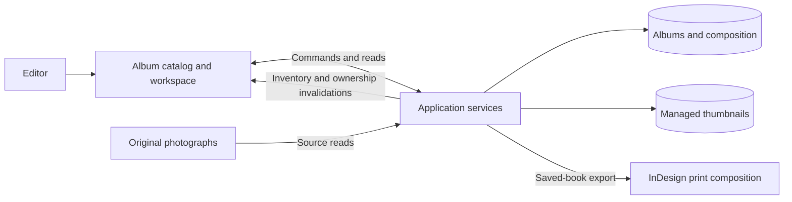
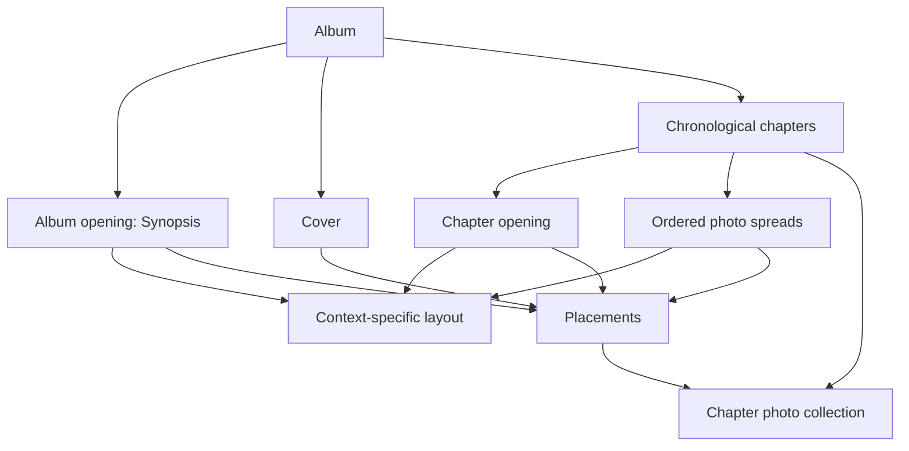
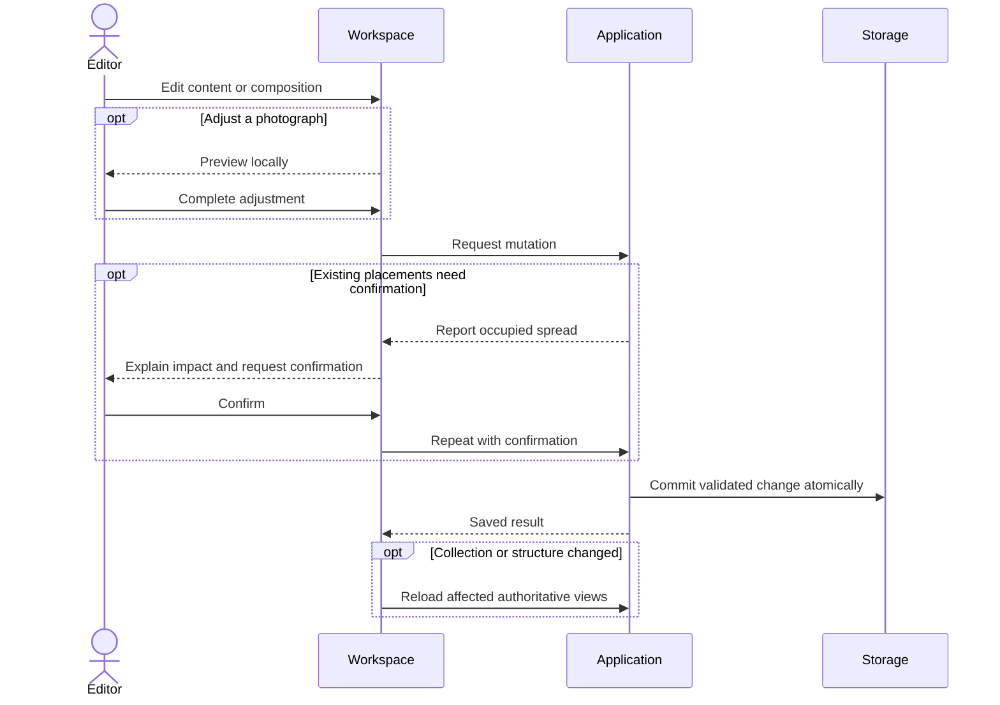
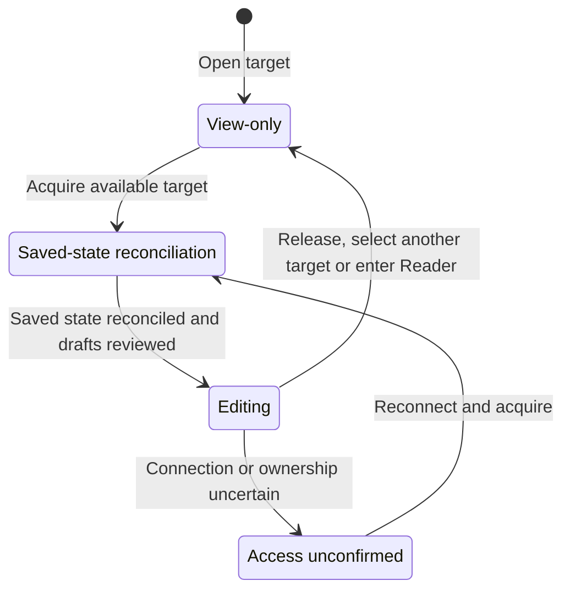
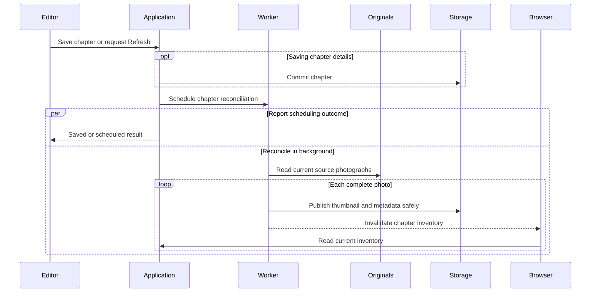

# Photography design

## Purpose and system boundary

Album Layout Studio turns a year's chapter-organized photographs into a saved book for browser presentation and InDesign print composition. The browser combines a photo collection, a spread editor and Reader; the backend owns saved state.

[Operations](operational.md#run-on-the-nas) owns deployment topology; [local safety](../.agents/skills/sdd/local.md#storage-and-deployment-safety) owns protection of independently retained photographs and state.

## Album model

An album has a unique, immutable year and an editable title. Chapters describe destinations and visit periods; Home represents the whole year and remains last. The interior starts with Synopsis, followed by chapter blocks whose openings stay ahead of their photo spreads.

Content owners retain editorial text independently of layout:

| Owner | Content and relationship |
| --- | --- |
| Album | Synopsis and a nonempty author selection from which Cover credits derive. |
| Chapter | Plain-text description and ordered gear selection, separate from destination and visit-period metadata. |
| Photo | Caption retained independently of placement. |
| Interior placement | Caption position within the layout, separate from photo-owned text. |

Cameras and lenses have independent, shared catalog lifecycles; chapters select compatible equipment rather than owning catalog entries. A lens can serve several bodies, so changing or deleting one entry must preserve the validity of every saved selection that references it.

Gear compatibility is a pure catalog-relative domain rule; application operations acquire current catalog state before applying it, while database constraints preserve references and atomic persistence. [Contracts](contracts.md) link the authoritative selection rules and representations.

Composition is bounded by the physical book: at most 65 interior spreads, excluding Cover. Templates provide layout geometry for their context; reference catalogs remain data, not duplicated application policy.

Cover artwork dimensions derive from the actual interior page count and persisted print specifications. The saved spine owner includes the spine in its photograph's frame.

Photos belong to chapter collections independently of their use in layouts. Chapter spreads use their chapter's photos; Synopsis and Cover can use the album collection. Removing a spread releases its placements rather than deleting its photographs.

## Editing journey

The catalog opens a workspace for creating or editing a book. Workspace navigation keeps the selected part addressable across navigation and reloads; Reader presents the same saved book without editing controls.

Catalog, workspace and Reader share saved-composition presentation. They preserve editorial text, derive supporting information from structured data and use the authoritative Cover frames; catalog re-entry refreshes both cover faces and the actual interior page count.

The workspace owns navigation, focus and context-specific template controls. Structural editing owns chapter-bound commands and history reconciliation; photo editing saves placements and transforms for interior layouts and Cover.

[UX patterns](../frontend/UX-PATTERNS.md) routes control placement, visual presentation and interaction conventions.

### Layout policy

Bleed is a spread-wide mode shared by imported and newly created spreads. It preserves template geometry and placement identities.

| Composition | Bleed behavior |
| --- | --- |
| Full-height outer photo | Bleeds top, bottom and outward; the opposite stack stays inset. |
| Outer stacks without a full-height outer photo | Both stacks bleed outward. |
| Inner slots | Remain inset. |
| Mixed saved directions | Remain readable without mutation; the toggle is disabled with an explanation. |

Standard directions can be enabled or cleared through the spread save and ownership boundary.

### Save and recovery

Local photo adjustments preview immediately; completed adjustments save in order. Cancellation preserves saved state; rejected saves retain the draft or explicitly unsaved preview with recovery feedback.

Each validated mutation commits within its owning boundary and preserves unrelated content and composition. An edit spanning several owners is not one transaction: chapter metadata resolves before gear commits separately.

| Client knowledge | Recovery |
| --- | --- |
| Write acknowledged, result delivery failed | Retry authoritative reads; retain the committed write. |
| Write outcome uncertain | Reconcile saved state before another write attempt. |
| Some owners saved, others unresolved | Preserve the saved portion and retry only unresolved work. |
| Authoritative state unavailable | Report failure; retain the last usable view rather than publish successful empty content. |

### Undo/Redo and navigation

Book editing has one browser-local Undo/Redo chronology over completed user intent, including edits spanning several content owners. Navigation and Reader retain that intent without retaining editing authority; album exit, reload or unexpected access loss ends its lifetime.

Reversal uses ordinary commands and current ownership to preserve unrelated work. It restores visible composition rather than whole-album snapshots; retained history follows regenerated identities.

Compensation is best effort, not an atomic restoration transaction: interrupted work retains progress, and a blocked or uncertain newest action stops traversal. Chapter creation and source-photo replacement establish explicit history boundaries; shared-catalog changes remain independently owned.

Navigation resolves pending edits and uncertain saves before leaving. Saves and temporary guards preserve spatial context, visible controls and layout; guards expose accessible reasons, and errors retain visible recovery actions.

Focus follows the owning edit or recovery surface without stealing unrelated focus or scrolling the workspace.

## Browser editing ownership

A browser profile remembers its identity and automatically chosen, editable alias. An alias identifies an editor; it does not authenticate a user.

| Lifetime | Authority and release |
| --- | --- |
| Tab connection | Established before application access; only one application tab per profile is admitted. Extra tabs wait for release. Stream closure releases only that exact connection. |
| Session | Has its own liveness lease; releasing a target keeps the session. A live session and grant can resume after reload. |
| Target grant | One session may own one interior spread or the full exterior Cover. Release or expiry permits acquisition; other profiles view saved state and the owner's alias without forced takeover. |

Only accepted session heartbeats and target renewals extend their respective leases. Stream keepalives detect disconnected tabs without renewing editing authority.

| Protected by target ownership | Independently writable |
| --- | --- |
| Composition, placed-photo captions, synopsis, chapter-opening descriptions, template changes and spread deletion | Album title; chapter name, countries, dates, source and gear; shared catalogs; author selection; nondestructive insertion/reordering; photo-source processing |

Leaving the album releases target ownership. View-only presentation retains photographs, captions and opening text, independent chapter details, Reader and recoverable drafts.

Ownership events let waiting viewers attempt acquisition after resolving local work. Only successful acquisition and saved-state reconciliation enable editing; notifications do not grant access.

Connection or ownership uncertainty retains drafts; backend loss makes the application unavailable. Reacquisition never replays drafts automatically.

## Photo processing and live views

Chapter saves commit independently of background photo processing. Creation, a changed source folder or an explicit Refresh initiates reconciliation; opening an album reads saved state.

The backend processes one chapter source at a time; other requested chapters remain queued. Superseded work releases that capacity without publishing stale photos.

Complete photos become visible progressively. Replacement and recoverable processing failures retain usable data; source reconciliation preserves authored captions independently of updated metadata and thumbnails.

Durable write intents bridge SQLite and thumbnail updates so interrupted publication and cleanup can finish after restart.

### Saved-view reconciliation

Inventory and ownership events invalidate views; they are not a second database. The browser reads ordinary saved edits on navigation, editing acquisition and reconnect rather than streaming them into an already-open view.

| Boundary | Guarantee |
| --- | --- |
| Workspace acquisition | Assembles content, structure, composition and photo inventories that agree on identities, chapter blocks and opening order. Retries incoherent acquisition at most twice, then reports failure while retaining the last usable view. |
| Selected spread or Cover | Supplies saved geometry and placements together for editing and Reader; reconciliation preserves pending adjustments and uncertain-write feedback. |
| View publication | Acknowledged saved state takes precedence over older in-flight reads; background acquisition cannot undo a successful edit. |

## Architectural decisions

Domain and application policy stay independent of HTTP, SQLite and image/filesystem adapters. The composition root supplies concrete infrastructure under the shared [design principles](../DESIGN-PRINCIPLES.md).

| Owner | Responsibility |
| --- | --- |
| Domain | Defines valid content, relationships and catalog-relative rules. |
| Application operations | Acquire authoritative facts and coordinate owned changes, saved-book export and photo processing. |
| Editing authority | Owns browser access and shared mutation coordination. |
| HTTP adapters | Translate credentials and exposed representations; routes declare access requirements. |
| SQLite adapters | Validate and atomically persist supplied owned decisions and representations. |
| Original-photo and thumbnail adapters | Keep source discovery/reading separate from managed-thumbnail storage; preserve causes and commit uncertainty. |
| Runtime | Owns resource acquisition and release. |
| InDesign | Owns local resources and final print composition. |

Print export reads saved facts from their existing owners and assembles print readiness and handoff after editing has stopped.

### Mutation coordination

Protected mutations check current relationships and live session, connection and grant authority in the same interval as completion. Description writes resolve the chapter's current opening in that interval; slow source and image work stays outside it.

A write admitted while ownership is live may finish atomically across expiry; competing acquisition waits and observes that result. Expired or superseded credentials cannot authorize a later admission.

Shared protected writes prove caller-owned grants and reject atomically when any affected target belongs to another session. Failed relationship reads remain errors rather than an empty affected set.

Placement, structural editing and photo reconciliation share coordination, preserving collection ownership and exclusive photo use across interior and Cover. The interior composition owner decides observed-order replacement and preserves opening and membership atomically.

### Authoritative acquisition

Workspace and editing reuse saved-composition acquisition; workspace adds chapter membership. Catalog and album metadata writes acquire only their needed saved facts.

Chapter planning derives complete ordered decisions from chapter metadata and the actual interior spread count. Application operations own contextual photo-processing failure diagnostics.

[Contracts](contracts.md) links exact representations and domain rules. [Testing](testing.md) maps guarantees to evidence; [operations](operational.md) owns deployment, stored state and recovery.
