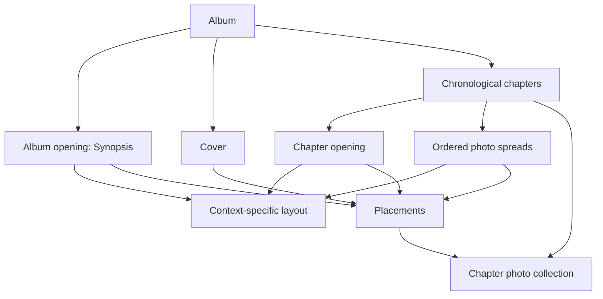
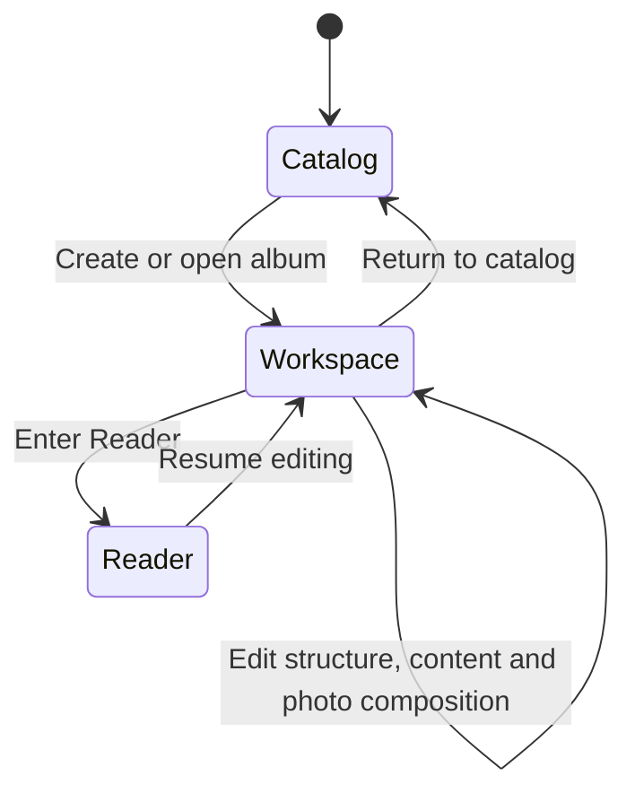
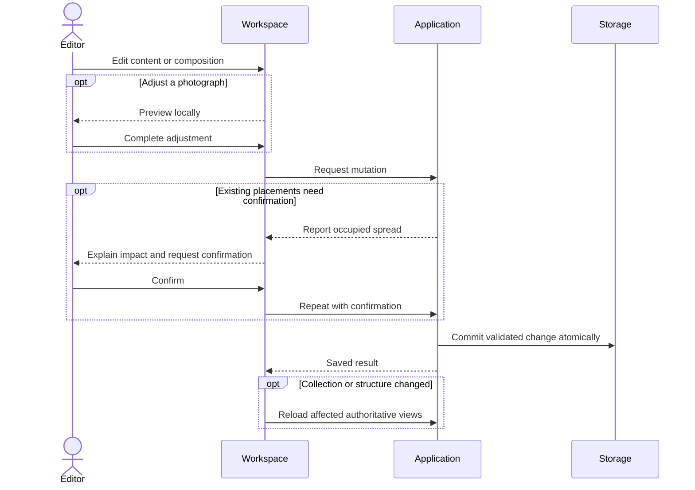
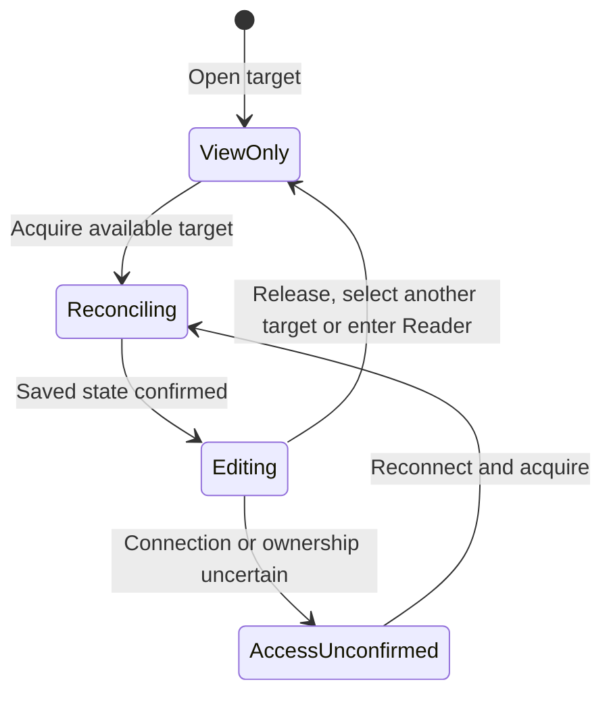
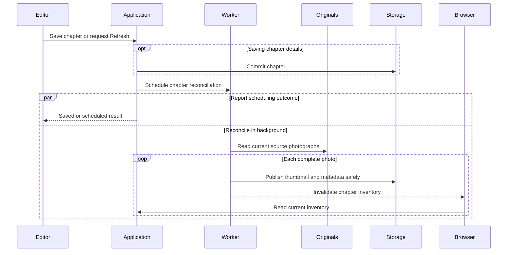

# Photography design

> Standard: Agentic Engineering Standards v1.2.0

## Purpose and system boundary

Album Layout Studio turns a year's chapter-organized photographs into a saved book for browser presentation and InDesign print composition. The browser combines a photo collection, a spread editor and Reader; one backend serves the application and owns saved state.

Original photographs remain independently owned. The application stores editorial decisions and derived previews, rather than becoming the authoritative photo archive.

## Album model

An album has a unique, immutable year and an editable title. Chapters describe destinations and visit periods; Home represents the whole year and remains last. The interior starts with Synopsis, followed by chapter blocks whose openings stay ahead of their photo spreads.

Content owners retain editorial text independently of layout:

| Owner | Content and relationship |
| --- | --- |
| Album | Synopsis and a nonempty author selection from which Cover credits derive. |
| Chapter | Plain-text description and ordered gear selection, separate from destination and visit-period metadata. |
| Photo | Caption retained independently of placement. |
| Interior placement | Caption position within the layout, separate from photo-owned text. |

Cameras and lenses have independent, shared catalog lifecycles; chapters select compatible equipment rather than owning catalog entries. A lens can serve several bodies, so changing or deleting one entry must preserve the validity of every saved selection that references it.

Gear compatibility is a pure catalog-relative domain rule; application operations acquire current catalog state before applying it, while database constraints preserve references and atomic persistence. [Contracts](contracts.md) link the authoritative selection rules and representations.

Editing, navigation and Reader share presentation policy over saved composition. Presentation preserves editorial text and derives headings and supporting information from structured data.

Composition is bounded by the physical book: at most 65 interior spreads, excluding Cover. Templates provide layout geometry for their context; reference catalogs remain data, not duplicated application policy.

Cover artwork dimensions derive from the actual interior page count and persisted print specifications. The saved spine owner includes the spine in its photograph's frame; catalog, editor and Reader share those authoritative frames and saved transforms.

Photos belong to chapter collections independently of their use in layouts. Chapter spreads use their chapter's photos; Synopsis and Cover can use the album collection. Removing a spread releases its placements rather than deleting its photographs.

## Editing journey

| Surface | Responsibility and guarantee |
| --- | --- |
| Workspace | Keeps the selected part addressable and restores it across navigation/reloads; owns navigation, focus and context-specific template controls. |
| Structural editing | Owns chapter-bound commands and history reconciliation. |
| Photo editing | Saves placements and transforms for interior layouts and Cover; derives collection availability from saved placements. |
| Reader | Presents the same saved book content and composition without editing controls. |
| Album catalog | Displays both saved cover faces and the actual interior page count; refreshes on re-entry. |
| Synopsis editing | Owns album renaming without coupling title ownership to composition. |

### Layout policy

Bleed is a spread-wide mode shared by imported and newly created spreads. It preserves template geometry and placement identities.

| Composition | Bleed behavior |
| --- | --- |
| Full-height outer photo | Bleeds top, bottom and outward; the opposite stack stays inset. |
| Outer stacks without a full-height outer photo | Both stacks bleed outward. |
| Inner slots | Remain inset. |
| Mixed saved directions | Remain readable without mutation; the toggle is disabled with an explanation. |

Standard directions can be enabled or cleared through the spread save and ownership boundary. [UX patterns](../frontend/UX-PATTERNS.md) and the frontend own control placement and presentation.

### Save and recovery

| Outcome or condition | Guarantee |
| --- | --- |
| Local photo adjustment | Preview remains responsive; completed adjustments save in order. |
| Cancellation or rejected save | Saved state remains intact; rejected saves retain the draft or unsaved preview with recovery feedback. |
| Validated mutation | Commits within its owning boundary and preserves unrelated content and composition. |
| Acknowledged write, failed result delivery | Recovery retries authoritative reads rather than replaying the mutation. |
| Uncertain write outcome | Reconcile saved state before another write; unavailable state is an explicit failure, not successful empty content. |
| Edit spans several owners | Chapter metadata resolves before gear commits separately; recovery preserves the saved portion and retries only unresolved work. |

### Undo/Redo and navigation

Book editing has one browser-local Undo/Redo chronology over completed user intent, including edits spanning several content owners. Navigation and Reader retain that intent without retaining editing authority; album exit, reload or unexpected access loss ends its lifetime.

Reversal uses ordinary authoritative commands and current ownership, preserving unrelated work rather than restoring whole-album snapshots. Visible composition can be restored with regenerated identities, which retained history follows.

Compensation is best effort, not an atomic restoration transaction: interrupted work retains progress, and a blocked or uncertain newest action stops traversal. Chapter creation and source-photo replacement establish explicit history boundaries; shared-catalog changes remain independently owned.

Editing preserves spatial context through saves. Temporary guards prevent conflicting actions without hiding controls or shifting layout; accessible reasons, errors and recovery actions remain visible.

Navigation resolves pending edits and uncertain saves before leaving. Focus follows the owning edit or its recovery surface without stealing unrelated focus or scrolling the workspace.

## Browser editing ownership

A browser profile remembers its identity and automatically chosen, editable alias. An alias identifies an editor; it does not authenticate a user.

| Lifetime | Authority and release |
| --- | --- |
| Tab connection | Established before application access; only one application tab per profile is admitted. Extra tabs wait for release. Stream closure releases only that exact connection. |
| Session | Has its own liveness lease; releasing a target keeps the session. A live session and grant can resume after reload. |
| Target grant | One session may own one interior spread or the full exterior Cover. Release or expiry permits acquisition; other profiles view saved state and the owner's alias without forced takeover. |

Selecting another target releases the previous grant before acquiring the destination or showing it view-only. Entering Reader or leaving the album releases target ownership.

| Protected by target ownership | Independently writable |
| --- | --- |
| Composition, placed-photo captions, synopsis, chapter-opening descriptions, template changes and spread deletion | Album title; chapter name, countries, dates, source and gear; shared catalogs; author selection; nondestructive insertion/reordering; photo-source processing |

Description writes resolve the chapter's current opening under the same coordination as ownership admission and persistence. View-only presentation retains photographs, captions and opening text, while independent chapter details, Reader and recoverable drafts remain available.

Ownership events are invalidations: waiting viewers may attempt acquisition after resolving local work, but only successful acquisition and saved-state reconciliation enable editing.

Connection or ownership uncertainty blocks editing and retains drafts; backend loss makes the application unavailable. Reconnection or reacquisition requires authoritative reconciliation and explicit draft review, never automatic replay.

## Photo processing and live views

Chapter saves commit independently of background photo processing. Creation, a changed source folder or an explicit Refresh initiates reconciliation; opening an album reads saved state.

The backend processes one chapter source at a time; other requested chapters remain queued. Superseded work releases that capacity without publishing stale photos.

Complete photos become visible progressively, retaining existing usable data during replacement or recoverable processing failure. Source reconciliation preserves authored captions independently of updated metadata and thumbnails.

Durable write intents bridge database and filesystem updates so restart recovery can finish interrupted publication and cleanup.

### Saved-view reconciliation

Inventory and ownership events invalidate views; they are not a second database. The browser reads ordinary saved edits on navigation, editing acquisition and reconnect rather than streaming them into an already-open view.

| Boundary | Guarantee |
| --- | --- |
| Workspace acquisition | Assembles content, structure, composition and photo inventories that agree on identities, chapter blocks and opening order. Retries incoherent acquisition at most twice, then reports failure while retaining the last usable view. |
| Selected spread or Cover | Supplies saved geometry and placements together for editing and Reader; reconciliation preserves pending adjustments and uncertain-write feedback. |
| View publication | Acknowledged saved state takes precedence over older in-flight reads; background acquisition cannot undo a successful edit. |

## Architectural decisions

Domain and application policy stay independent of HTTP, SQLite and image/filesystem adapters. The composition root supplies concrete infrastructure under the shared [design principles](../DESIGN-PRINCIPLES.md).

| Owner | Responsibility |
| --- | --- |
| Application operations | Acquire authoritative facts, validate relationships and coordinate owned changes; assemble saved-book export and classify photo-processing outcomes. |
| Content managers | Retain business validation for their content owners. |
| Editing authority | Owns volatile browser access and shared mutation coordination in one backend. |
| HTTP adapters | Translate credentials and exposed representations; routes declare access requirements. |
| SQLite adapters | Validate and atomically persist supplied owned decisions and representations. |
| Original-photo and thumbnail adapters | Keep source discovery/reading separate from managed-thumbnail storage; preserve causes and commit uncertainty. |
| Runtime | Owns resource acquisition/release and completes recovery before serving. |
| InDesign | Owns local resources and final print composition. |

Print export reads saved facts from their existing owners and assembles print readiness and handoff after editing has stopped.

### Mutation coordination

Protected mutations check current relationships and live session, connection and grant authority in the same interval as completion. Slow source and image work stays outside that critical section.

A write admitted while ownership is live may finish atomically across expiry; competing acquisition waits and observes that result. Expired or superseded credentials cannot authorize a later admission.

Shared protected writes prove caller-owned grants and reject atomically when any affected target belongs to another session. Failed relationship reads remain errors rather than an empty affected set.

Placement, structural editing and photo reconciliation share coordination, preserving collection ownership and exclusive photo use across interior and Cover. The interior composition owner decides observed-order replacement and preserves opening and membership atomically.

### Authoritative acquisition

Workspace and editing reuse saved-composition acquisition; workspace adds chapter membership. Catalog and album metadata writes use lightweight saved facts rather than reacquiring the full book.

Chapter planning derives complete ordered decisions from chapter metadata and the actual interior spread count. Application operations select Cover dimensions from the saved sizing catalog and own contextual photo-processing failure diagnostics.

[Contracts](contracts.md) links exact representations and domain rules. [Testing](testing.md) maps guarantees to evidence; [operations](operational.md) owns deployment, stored state and recovery.
