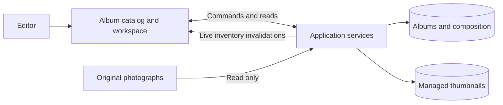
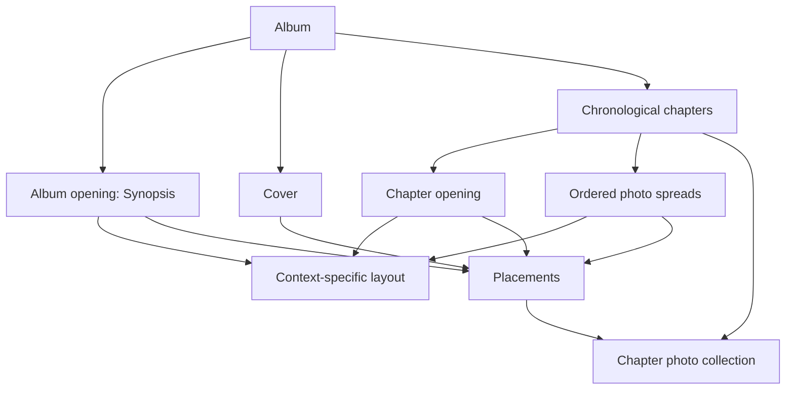
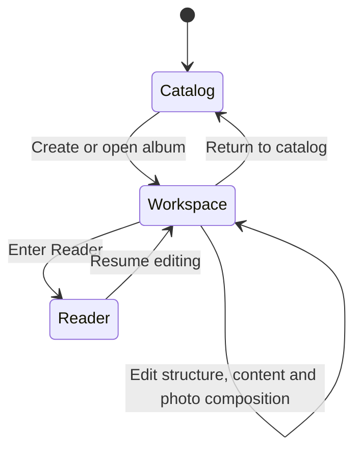
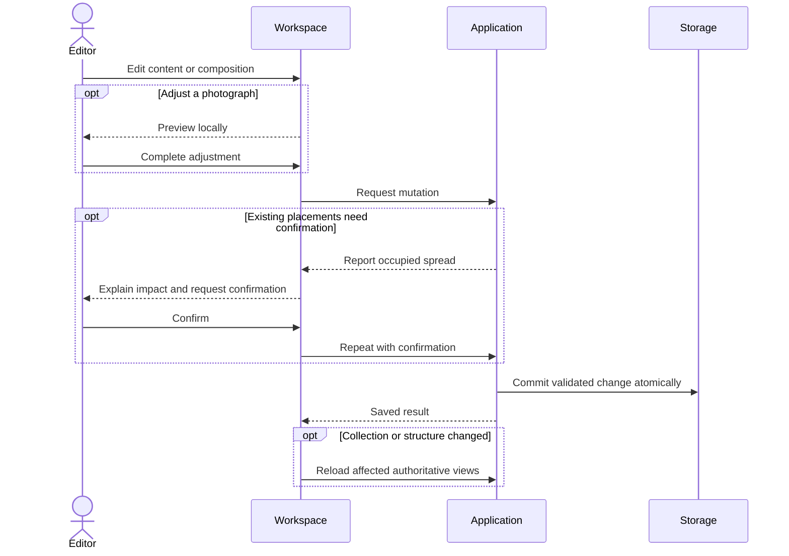
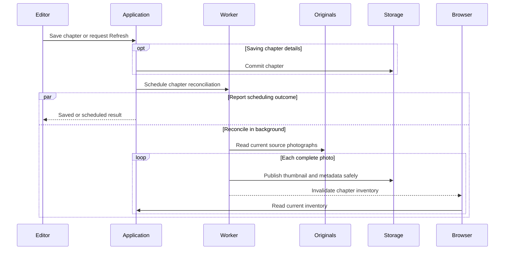

# Photography design

> Standard: Agentic Engineering Standards v1.2.0

## Purpose and system boundary

Album Layout Studio turns a year's chapter-organized photographs into a persisted album composition. The browser combines a photo collection, a spread editor and a distraction-free Reader; one backend serves the application and owns saved state.

Original photographs remain independently owned. The application stores editorial decisions and derived previews, rather than becoming the authoritative photo archive.

## Album model

An album has a unique, immutable year and an editable title. Chapters describe destinations and visit periods; Home represents the whole year and remains last. The interior starts with Synopsis, followed by chapter blocks whose openings stay ahead of their photo spreads.

Editorial content belongs to the book's domain owners, independently of layout:

| Owner | Content and relationship |
| --- | --- |
| Album | Synopsis and a nonempty author selection from which Cover credits derive. |
| Chapter | Plain-text description and ordered gear selection, separate from destination and visit-period metadata. |
| Photo | Caption retained independently of placement. |
| Interior placement | Caption position within the layout, separate from photo-owned text. |

Cameras and lenses have independent, shared catalog lifecycles; chapters select compatible equipment rather than owning catalog entries. A lens can serve several bodies, so changing or deleting one entry must preserve the validity of every saved selection that references it.

The application decides compatibility against current catalog state, while database constraints preserve references and atomic persistence. [Contracts](contracts.md) link the authoritative selection rules and representations.

Book presentation preserves editorial text and derives headings and supporting information from structured data. Formatting is a projection of saved state, not another source of truth for content or catalog identities.

Composition is bounded by the physical book: at most 65 interior spreads, excluding Cover. Templates provide layout geometry for their context; reference catalogs remain data, not duplicated application policy.

Photos belong to chapter collections independently of their use in layouts. Chapter spreads use their chapter's photos; Synopsis and Cover can use the album collection. Removing a spread releases its placements rather than deleting its photographs.

## Editing journey

The workspace keeps the selected part addressable and restores it across navigation and reloads. Structural editing operates within chapter boundaries; template choices follow the selected spread's context.

Photo editing persists placements and transforms for interior layouts and Cover; collection availability is derived from saved placements. Reader presents the same saved book content and composition without editing chrome.

Local previews stay responsive while completed adjustments save in order. Failed saves retain an explicitly unsaved preview for recovery.

Cancellation preserves saved state, and rejected saves retain the draft with recoverable feedback. Validated mutations commit within their owning boundary, preserving unrelated content and composition.

Saving and delivering the saved result are distinct outcomes: once a write is acknowledged, recovery retries authoritative reads rather than replaying the mutation. Uncertain outcomes are reconciled before another write attempt; unavailable state remains an explicit failure rather than successful empty content.

An editor spanning several owners does not imply an all-or-nothing transaction. Chapter metadata resolves before gear commits separately; partial-save recovery preserves the saved portion and retries only unresolved work.

Editing keeps book content primary and preserves the user's spatial context through saves. Temporary guards prevent conflicting actions without hiding controls or shifting the layout; their reasons are accessible, while errors and recovery actions remain visible.

Navigation resolves pending edits and uncertain saves before leaving. Focus follows the owning edit or its recovery surface without stealing unrelated focus or scrolling the workspace.

## Photo processing and live views

Chapter saves commit independently of background photo processing. Creation, a changed source folder or an explicit Refresh initiates reconciliation; opening an album reads saved state.

Complete photos become visible progressively, retaining existing usable data during replacement or recoverable processing failure. Source reconciliation preserves authored captions independently of updated metadata and thumbnails.

Durable write intents bridge database and filesystem updates so restart recovery can finish interrupted publication and cleanup.

The browser treats live events as invalidations, not a second database. Initial loads and reconnects assemble fresh album metadata, ordered chapters, composition membership, individual spreads and chapter photo inventories from authoritative resource reads. Independently acquired resources must agree on identities, chapter blocks and opening order before becoming the displayed workspace; incoherent acquisition is retried at most twice, with explicit failure and the last usable view retained if reconciliation fails. Country and template catalogs are independent resources. Ordinary composition changes become visible to other workspaces on reload.

Each saved spread supplies its geometry and placements together for editing and Reader. Navigation reuses the acquired resource; authoritative refreshes reconcile saved state without discarding pending adjustments or uncertain-write feedback. Cover is acquired when selected and refreshed on reconnect, while in-flight reads and unresolved saves retain their owning recovery lifecycle.

Acknowledged saved state takes precedence over older in-flight reads. Workspace views reconcile authoritative state before publication so background acquisition cannot undo a successful edit.

## Architectural decisions

Domain and application policy stay independent of HTTP, SQLite and image/filesystem adapters, following [Design principles](../DESIGN-PRINCIPLES.md). The composition root supplies concrete infrastructure.

The supported topology is one backend instance. Shared mutation coordination protects read/decision/write decisions; database transactions make supplied changes atomic. Slow source and image work runs outside that critical section.

Browser photo editing mutates placement resources; the interior composition owner also decides observed-order replacement, preserving the opening and membership atomically. Lightweight album, chapter and membership reads use their existing persistence authorities and representation validation, while atomic business workflows retain aggregate acquisition. Placement, structural editing and photo reconciliation share mutation coordination, preserving collection ownership and exclusive photo use across interior and Cover. The runtime owns resource acquisition and release, with recovery completed before serving. [Contracts](contracts.md) identify authoritative representations; [operations](operational.md) owns deployment and recovery.
