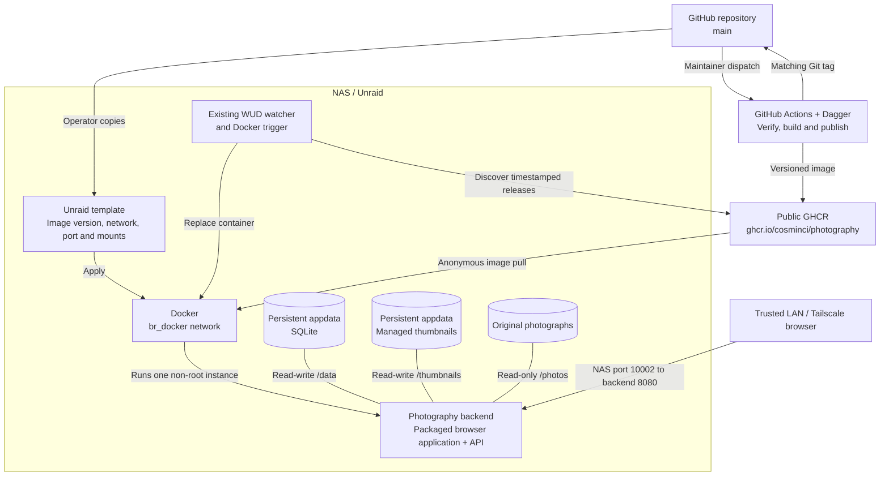

# Photography operations

> Standard: Agentic Engineering Standards v1.2.0

## Run locally

Install the pinned toolchain as described in [Contributing](../CONTRIBUTING.md#setup). From the repository root, run:

```sh
python3 scripts/local.py
```

The launcher builds frontend assets, starts the backend and development server, and reports their URLs after readiness. The default URLs are `127.0.0.1:8080` and `127.0.0.1:5173`; local SQLite state lives under `.local/`.

For isolated work, set the SQLite, original-photo and thumbnail paths before starting. The launcher overrides the database default only; explicitly choose a writable thumbnail directory and read-only originals.

Stop with Ctrl+C. The launcher stops its owned process groups, including descendants whose parent has already exited; preserve unrelated services and retained data.

## Configuration

| Concern | Setting and authority |
| --- | --- |
| SQLite, originals and thumbnails | `PHOTOGRAPHY_SQLITE_PATH`, `PHOTOGRAPHY_PHOTO_ROOT`, `PHOTOGRAPHY_THUMBNAIL_ROOT`; [application configuration](../backend/src/main/resources/application.conf) owns defaults. |
| Backend listener | `PHOTOGRAPHY_HOST`, `PHOTOGRAPHY_PORT`; invalid application configuration stops startup. |
| Local development server | `PHOTOGRAPHY_FRONTEND_PORT` selects a separate verification port. |
| Preview quality | `PHOTOGRAPHY_THUMBNAIL_QUALITY`; application configuration owns supported defaults. |
| Browser-local history | `VITE_BOOK_HISTORY_LIMIT`; [frontend configuration](../frontend/src/app/AppConfig.ts) owns its default and validation. |

Browser-local history capacity is fixed at development-server startup or asset build time. Rebuild deployed assets to change it.

## Run on the NAS

Use one backend instance with durable SQLite and thumbnail storage, and mount original photo directories read-only. The backend serves the built application and API together; the frontend development server is unnecessary on the NAS.

Deploy a versioned, non-root application image with anonymous registry access. The [operator runbook](../unraid/README.md) owns installation, updates and recovery procedures.



The [release workflow](../.github/workflows/release.yml) owns publication; the [Unraid template](../unraid/photography.xml) owns exact host paths and container settings. WUD replacement requires backup coordination: SQLite and referenced thumbnails form one recovery unit.

| Storage | Ownership and operating requirement |
| --- | --- |
| SQLite | Persistent application state; run only one backend against it. |
| Managed thumbnails | Derived media; back up consistently with database references. |
| Original photographs | Independently owned source material; saved chapter paths must be visible to the backend. |

### Network and proxy boundary

Keep the listener on a trusted network or behind an authenticated reverse proxy; the application does not provide user authentication.

Trusted-network HTTP supports browser editing coordination. Preserve private headers and unbuffered, uncached Server-Sent Events through proxies; transport keepalives detect disconnected tabs without renewing editing leases.

Preserve immutable thumbnail caching independently of API and event responses. [OpenAPI](http-api.openapi.json) owns credential, lease and transport details.

## Editing access and recovery

The single backend keeps session and target authority in memory. Accepted session heartbeats and target renewals extend separate leases; a failed heartbeat extends nothing.

| Condition | Recovery behavior or action |
| --- | --- |
| Backend restart | Old credentials and grants become invalid; saved albums and remembered browser identity/alias remain. |
| Extra tab blocked | Close the active tab and allow automatic binding retry; expiry releases an unresponsive browser. Retain remembered browser identity. |
| Crash or network loss | Lease expiry releases abandoned access. |
| Access unconfirmed | Reconnect and reconcile saved state before resubmitting retained drafts. |
| Backend unavailable | Application access is blocked. After restart or grant loss, review drafts explicitly; reacquisition never replays them. |

## Readiness, logs and metrics

Probe `GET /health` for HTTP readiness. Startup migrates SQLite and reconciles unfinished photo writes before opening the listener.

| Signal | Interpretation |
| --- | --- |
| `/health` | Startup completion and HTTP reachability, not continuous database/storage health. |
| Process output | SLF4J startup and failure diagnostics; retain application errors with migration and database-pool diagnostics. |
| Chapter inventory and processing feedback | Application-visible photo-processing progress and failures. |

Capture stdout/stderr with the local terminal or NAS supervisor. Monitor process availability, health responses and free space for database and thumbnail storage at the host level.

Host monitoring is an operating recommendation. Dedicated metrics export, dashboards and alert rules are not configured.

## Recovery and maintenance

The [NAS runbook](../unraid/README.md#backup-and-recovery) owns the stopped-state checkpoint and restore procedure for the paired storage shown above.

Pause automatic replacement while taking a consistent paired checkpoint, preferably with the backend stopped. Restore SQLite and thumbnails together; retain independent originals backups and preserve failed startup data/logs before intervention.

An older image does not reverse migrations. Choose compatible image/state for recovery and account for edits lost when restoring an earlier checkpoint.

After restart, unfinished thumbnail publication/cleanup is reconciled from durable intents. Source enumeration is explicit: use Refresh to resume interrupted photo processing. A failed scheduling attempt does not undo a saved chapter.

One chapter source is processed at a time to bound NAS image-processing load; other requests remain queued while saved-state viewing and editing stay available.

For checksum-incompatible disposable development databases, select a fresh database path or recreate only the explicitly identified disposable database. Retained spike data, NAS state and original photographs require their owner's authorization before replacement.
