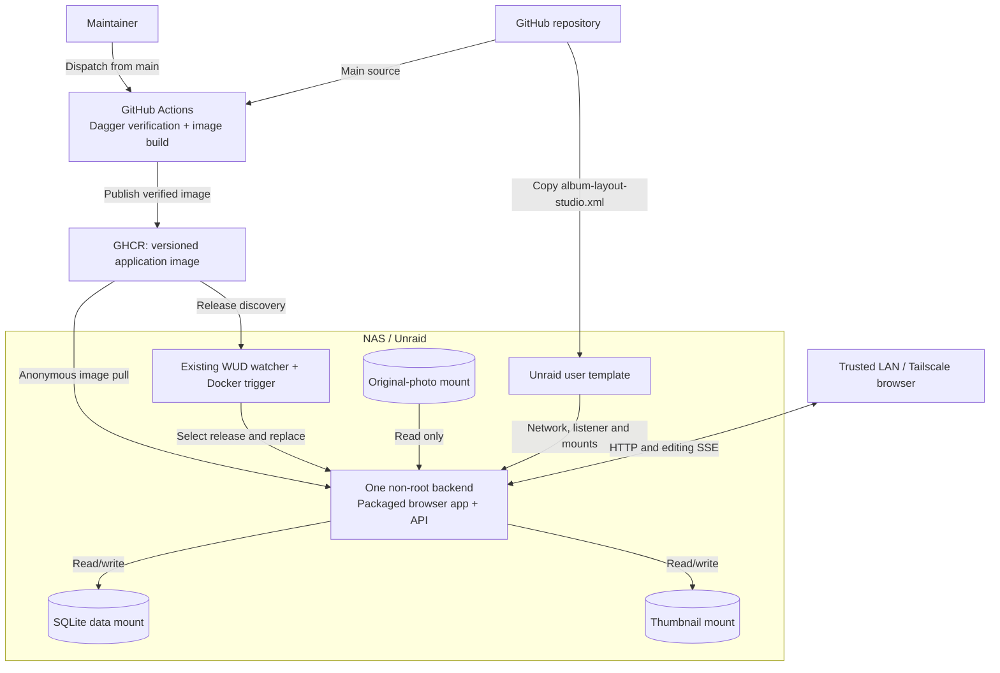
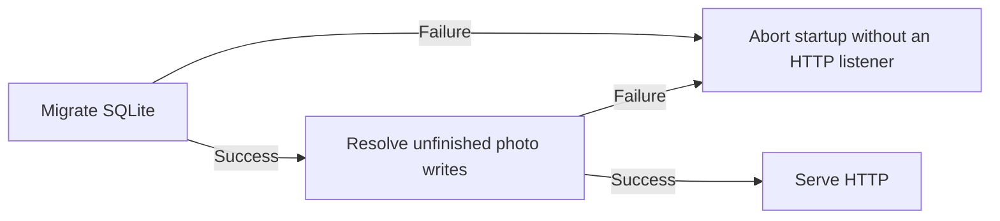

# Photography operations

## Run locally

Install the [contributor toolchain](../CONTRIBUTING.md#setup). Before startup, choose an isolated SQLite path, a writable thumbnail directory and a read-only original-photo root; the launcher changes only the database default, not the two media paths.

Run from the repository root, replacing the example paths with the approved locations:

```sh
export PHOTOGRAPHY_SQLITE_PATH="$PWD/.local/photography.db"
export PHOTOGRAPHY_THUMBNAIL_ROOT="$PWD/.local/thumbnails"
export PHOTOGRAPHY_PHOTO_ROOT="/absolute/path/to/originals"
python3 scripts/local.py
```

Wait for the launcher to report both ready URLs before opening the workspace. [The launcher](../scripts/local.py) owns default ports, its database location and readiness timeout; set `PHOTOGRAPHY_PORT` and `PHOTOGRAPHY_FRONTEND_PORT` before startup when another service occupies those ports.

Stop with Ctrl+C; the launcher stops its own process groups. For startup failure, inspect the reported prerequisite, port or backend error rather than stopping unrelated processes or deleting retained state.

## Frontend configuration

Browser-local history capacity is fixed at development-server startup or asset build time. Set `VITE_BOOK_HISTORY_LIMIT` to a positive safe integer to override it; deployment changes require rebuilding the assets.

## Run on the NAS



The [Unraid template](../unraid/album-layout-studio.xml) owns concrete ports, host paths, mount modes and WUD labels; the [runtime Dockerfile](../containers/photography/Dockerfile) owns the process identity and image defaults. Follow the [operator runbook](../unraid/README.md) to publish, install or update.

Keep the listener on a trusted network or behind an authenticated reverse proxy; the application does not provide user authentication.

[Application configuration](../backend/src/main/resources/application.conf) owns environment settings and defaults. Set `PHOTOGRAPHY_HOST`/`PHOTOGRAPHY_PORT` for the listener and `PHOTOGRAPHY_THUMBNAIL_QUALITY` for preview quality; invalid configuration stops startup.

Preserve [OpenAPI headers and cache policies](http-api.openapi.json) through proxies and disable SSE buffering. Keep event connections alive; transport keepalives do not renew editing leases.

## Editing access and recovery

For a blocked extra tab, close the active tab and allow automatic binding retry; after a browser crash, wait for access expiry. Do not clear remembered browser identity as a substitute for releasing the binding.

After backend restart or access loss, reconnect, reload saved state and review retained drafts before resubmitting. [Mutation authority](design.md#protected-mutation-admission) explains access lifetimes; [presentation recovery](design.md#presentation-at-the-backend-boundary) explains draft handling.

## Readiness, logs and metrics



[Write recovery](design.md#thumbnail-publication-and-recovery).

Probe `GET /health` for HTTP readiness. This establishes startup completion and reachability, not continuous database or storage health.

The backend writes startup and failure diagnostics through SLF4J to process output. Capture stdout/stderr with the local terminal or NAS supervisor; retain application errors alongside migration and database-pool diagnostics when investigating failures.

Chapter processing feedback identifies queued, progressing and failed work in the workspace. No metrics exporter, dashboard or alert rules are configured; arrange host checks for process availability, health responses and free space on the data/thumbnail volumes.

## Recovery and maintenance

1. Pause automatic replacement and stop the sole backend; confirm no process still uses its database.
2. Back up both the data directory, including SQLite sidecars, and referenced thumbnails in one stopped-state checkpoint. Include image version/digest and deployment configuration; retain originals through their independent backup.
3. Verify both directories are present before restarting or updating.

For failed startup, preserve logs and the failed database/thumbnail pair before intervention. Migration, configuration and permission failures do not authorize deleting state or reseeding.

To restore, keep the backend stopped and replacement paused, select a compatible image and matching checkpoint, restore both directories and verify runtime access. Start that version, check health, saved albums and thumbnail delivery, then reenable replacement.

An older image does not reverse migrations. Restoring an earlier checkpoint can lose later edits; obtain authorization for that loss and never combine it with journals that claim newer saved work.

Use Refresh to resume interrupted source enumeration after restart. For a scheduling failure after a chapter save, retry processing rather than recreating the saved chapter.

For checksum-incompatible disposable development databases, select a fresh database path or recreate only the explicitly identified disposable database. Retained spike data, NAS state and original photographs require their owner's authorization before replacement.

Before first deployment, schema/data evolution can update the initial migrations with migrated repository-seam evidence. Once deployed, preserve applied migrations and add versioned changes with upgrade evidence; retained spike data is not disposable merely because production has not started.

## Print handoff

Export the saved book after editing stops. Open the empty Saal InDesign template, then run [place-spreads.jsx](../scripts/indesign/place-spreads.jsx) or [place-cover.jsx](../scripts/indesign/place-cover.jsx) against the same exported JSON; InDesign resolves local print resources.
