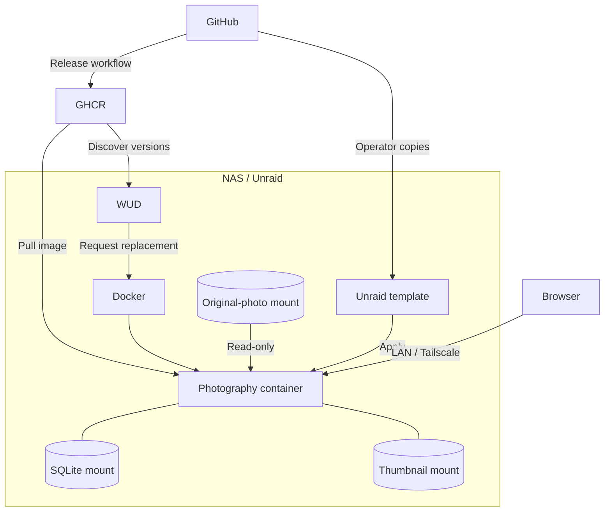

# Photography operations

## Deployment

One backend serves the browser application and API. The [template](../unraid/photography.xml) defines deployment settings; the [NAS runbook](../unraid/README.md) owns publication, installation and updates.

## State and recovery

SQLite and referenced thumbnails form one recovery unit. Follow [backup and recovery](../unraid/README.md#backup-and-recovery) for checkpoints and restoration.

Startup applies migrations and finishes interrupted photo publication before accepting requests. Use Refresh to resume interrupted source enumeration.

After a backend restart, reconnect and review retained editing drafts against saved state before submitting them.

## Monitoring

| Signal | Meaning |
| --- | --- |
| `/health` | Startup completed and HTTP is reachable; ongoing storage health is not established. |
| Process logs | Startup, migration and application failures. |
| Chapter processing feedback | Source reconciliation progress and failures. |

Monitor process availability and storage capacity at the host. Application metrics and alert rules are not configured.

## Local runtime

Follow [Contributing](../CONTRIBUTING.md) for setup. Run `python3 scripts/local.py` from the repository root; wait for its ready URLs. Ctrl+C stops the launcher's processes.

Choose isolated storage through [application configuration](../backend/src/main/resources/application.conf) before startup; the launcher overrides only the database path.

## Print handoff

Open the empty Saal template in InDesign. Run [place-spreads.jsx](../scripts/indesign/place-spreads.jsx) or [place-cover.jsx](../scripts/indesign/place-cover.jsx) against the same exported JSON.
