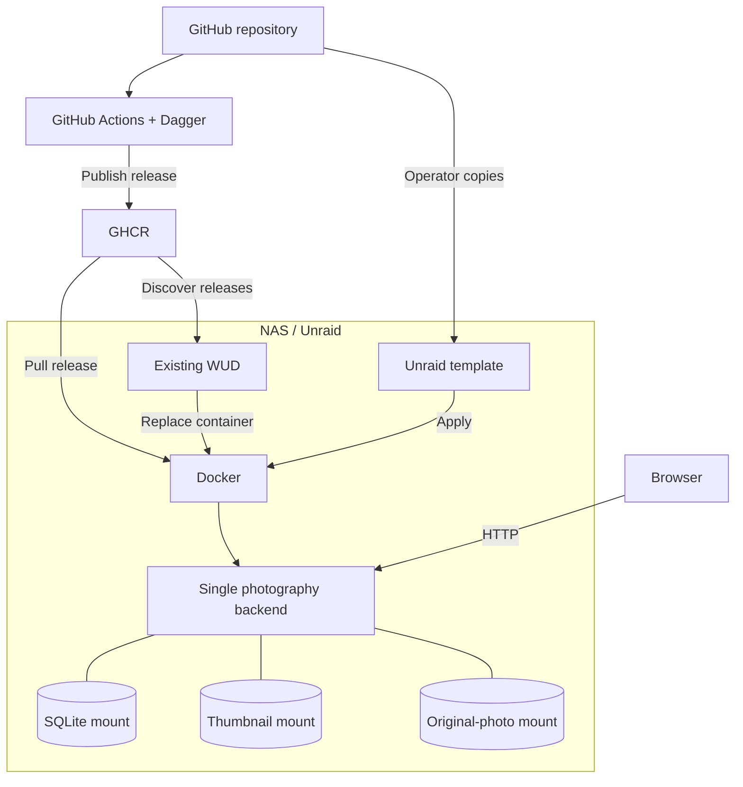

# Photography operations

## Run locally

Install the pinned toolchain as described in [Contributing](../CONTRIBUTING.md#setup). From the repository root, run:

```sh
python3 scripts/local.py
```

Wait for the launcher to report ready URLs before opening the application. The [launcher](../scripts/local.py) owns local defaults and dependency installation.

For isolated work, choose all storage paths before startup using [configuration contracts](contracts.md#consumed-contracts) and [storage safety](../.agents/skills/sdd/local.md#storage-and-deployment-safety). The launcher overrides the database default only.

Stop with Ctrl+C; the launcher shuts down its owned process groups, including descendants whose parent has exited.

## Configuration

Set runtime configuration before starting the backend; invalid values stop startup. Frontend configuration is fixed at development-server startup or asset build time, so rebuild deployed assets to change it.

## Print handoff

Follow the [export lifecycle](design.md#architectural-decisions) and [handoff contract](contracts.md#provided-contracts), then:

1. Open the empty Saal template in InDesign.
2. Run [place-spreads.jsx](../scripts/indesign/place-spreads.jsx) or [place-cover.jsx](../scripts/indesign/place-cover.jsx) against the same exported JSON.

## Run on the NAS



The [Unraid template](../unraid/photography.xml) owns image, network, port, mount paths and access modes. Follow the [NAS runbook](../unraid/README.md) for publication, installation, exposure, updates and recovery; [pipeline contracts](../ci/specs/contracts.md#consumed-contracts) owns release dependencies.

## Editing access and recovery

For a blocked extra tab, close the active tab and allow automatic binding retry. Retain remembered browser identity while recovering access.

After restart or grant loss, reconnect, reconcile saved state and review retained drafts before submitting further edits. [Editing ownership](design.md#browser-editing-ownership) owns the authority lifecycle; [OpenAPI](http-api.openapi.json) owns credential invalidation.

## Readiness, logs and metrics

Probe `GET /health` for HTTP readiness.

| Signal | Interpretation |
| --- | --- |
| `/health` | Startup completion and HTTP reachability, not continuous database/storage health. |
| Process output | SLF4J startup and failure diagnostics; retain application errors with migration and database-pool diagnostics. |
| Chapter inventory and processing feedback | Application-visible photo-processing progress and failures. |

Capture stdout/stderr with the local terminal or NAS supervisor. Monitor process availability, health responses and free space for database and thumbnail storage at the host level.

Host monitoring is an operating recommendation. Dedicated metrics export, dashboards and alert rules are not configured.

## Recovery and maintenance

Startup applies migrations and completes durable photo-write recovery before opening the listener. [Photo processing](design.md#photo-processing-and-live-views) owns reconciliation guarantees and scheduling limits.

Use Refresh to resume source enumeration after an interruption. For checkpoint and restore actions, follow [NAS recovery](../unraid/README.md#backup-and-recovery).

For checksum-incompatible disposable development databases, select a fresh path or recreate only the identified disposable database under [storage safety](../.agents/skills/sdd/local.md#storage-and-deployment-safety).
