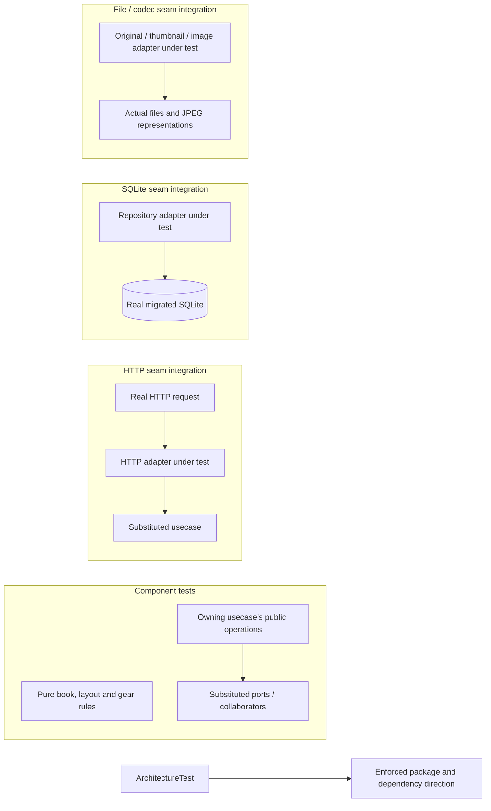

# Photography testing

## Evidence boundaries

## Backend evidence requirements

- Session-authority and editing-admission component tests prove admission, fencing and lease races. HTTP seams prove credential translation and stream finalization; SQLite seams prove actual commit/rollback.
- Import coordination, photo reconciliation and write-recovery component tests prove source-generation scheduling, publication ordering and committed-reference cleanup respectively. Real repository/file seams establish durable evidence and filesystem guarantees.
- Arrange failed, missing, rejected and uncertain outcomes separately; observe complete results and requested effects. An acknowledged write followed by a failed read needs a different scenario from a write whose commit outcome is unknown.
- Saved-book export component tests prove acquisition, blocking issues, warnings and schema validity. They use saved records; local original-file availability and print fidelity require the consumer checks below.

## Nomenclature

Name domain and usecase suites `<Boundary>ComponentTest` and adapter suites `<Adapter>SeamIntegrationTest`; TypeScript uses the corresponding `.componentTest` and `.seamIntegrationTest` suffixes.

Every usecase or port trait must have exactly one owning test suite. Group its operation scenarios in that suite; a seam crosses its adapter's real external boundary, not a substituted exchange.

Keep architecture rules in one `ArchitectureTest` suite with one test. Case descriptions start with `should` and name the observable guarantee; keep runner-required prefixes such as Python's `test_`.

## Consumer checks and validation

Browser component tests use rendered accessible controls and real events, with collaborators substituted. Real-browser checks establish native selection/focus, profile/tab isolation, socket cancellation and draft/history recovery; [InDesign handoff](operational.md#print-handoff) checks actual originals, page geometry and final composition.

Map changed guarantees to owning scenarios and record results with change evidence. The [backend build](../backend/build.sbt) and [frontend test configuration](../frontend/vitest.config.ts) own coverage thresholds/exclusions; [contribution validation](../CONTRIBUTING.md#validation) owns gate commands, and [Dagger testing](../ci/specs/testing.md) owns verification infrastructure.
