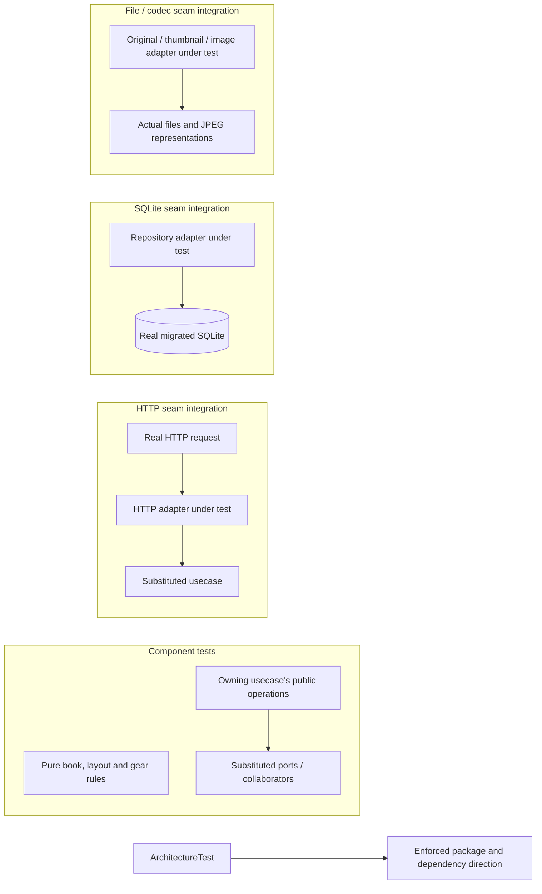

# Photography testing

## Evidence boundaries

## Backend evidence requirements

- Prove admission, fencing and lease races in [session](../backend/src/test/scala/photography/usecases/editing/EditorSessionManagerComponentTest.scala) and [editing-access](../backend/src/test/scala/photography/usecases/editing/EditingAccessComponentTest.scala) suites. Prove credential translation and stream finalization at HTTP seams, and actual commit/rollback at SQLite seams.
- Prove source-generation scheduling in [import](../backend/src/test/scala/photography/usecases/photo/ChapterPhotoImportComponentTest.scala), publication ordering in [photo reconciliation](../backend/src/test/scala/photography/usecases/photo/PhotoManagerComponentTest.scala), and committed-reference cleanup in [write recovery](../backend/src/test/scala/photography/usecases/photo/PhotoWriteRecoveryComponentTest.scala). Use real repository/file seams for durable evidence and filesystem guarantees.
- Arrange failed, missing, rejected and uncertain outcomes separately; observe complete results and requested effects. An acknowledged write followed by a failed read needs a different scenario from a write whose commit outcome is unknown.
- Prove saved-book acquisition, blocking issues, warnings and schema validity in [export](../backend/src/test/scala/photography/usecases/album/BookExportComponentTest.scala). Export component tests use saved records; they do not establish local original-file availability or print fidelity.

## Nomenclature

Name domain and usecase suites `<Boundary>ComponentTest` and adapter suites `<Adapter>SeamIntegrationTest`; TypeScript uses the corresponding `.componentTest` and `.seamIntegrationTest` suffixes.

Every usecase or port trait must have exactly one owning test suite. Group its operation scenarios in that suite; a seam crosses its adapter's real external boundary, not a substituted exchange.

Keep architecture rules in one `ArchitectureTest` suite with one test. Case descriptions start with `should` and name the observable guarantee; keep runner-required prefixes such as Python's `test_`.

## Consumer checks and validation

Browser component tests use rendered accessible controls and real events, with collaborators substituted. Real-browser checks establish native selection/focus, profile/tab isolation, socket cancellation and draft/history recovery; [InDesign handoff](operational.md#print-handoff) checks actual originals, page geometry and final composition.

Map changed guarantees to owning scenarios and record results with change evidence. The [backend build](../backend/build.sbt) and [frontend test configuration](../frontend/vitest.config.ts) own coverage thresholds/exclusions; [contribution validation](../CONTRIBUTING.md#validation) owns gate commands, and [Dagger testing](../ci/specs/testing.md) owns verification infrastructure.
